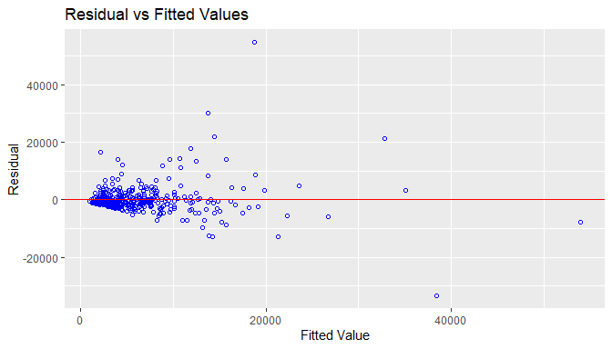

<!-- README.md is generated from README.Rmd. Please edit that file -->

# olsrr

<!-- badges: start -->

[](https://CRAN.R-project.org/package=olsrr)
[](https://github.com/rsquaredacademy/olsrr/actions/workflows/R-CMD-check.yaml)
[](https://app.codecov.io/gh/rsquaredacademy/olsrr?branch=develop)
<!-- badges: end -->

olsrr helps analysts build and check linear regression models, with
tools for diagnostics, variable selection and clear reports.

## Installation

``` r
# Release version from CRAN
install.packages("olsrr")

# Development version from GitHub
# install.packages("pak")
pak::pak("rsquaredacademy/olsrr")
```

## Quick example

### Read the regression output

Can grocery and detergents-and-paper spending explain milk spending?

``` r
# annual spend of 440 wholesale customers (UCI, CC BY 4.0; see ?wholesale_customers)
model <- lm(milk ~ grocery + detergents_paper, data = wholesale_customers)
ols_regress(model)
#>                              Model Summary                              
#> -----------------------------------------------------------------------
#> R                          0.729       RMSE                   5063.711 
#> R-Squared                  0.531       MSE                25641169.793 
#> Adj. R-Squared             0.529       Coef. Var                87.362 
#> Pred R-Squared             0.490       AIC                    8759.928 
#> MAE                     2563.777       SBC                    8776.275 
#> -----------------------------------------------------------------------
#>  RMSE: Root Mean Square Error 
#>  MSE: Mean Square Error 
#>  MAE: Mean Absolute Error 
#>  AIC: Akaike Information Criteria 
#>  SBC: Schwarz Bayesian Criteria 
#> 
#>                                       ANOVA                                        
#> ----------------------------------------------------------------------------------
#>                        Sum of                                                     
#>                       Squares         DF       Mean Square       F           Sig. 
#> ----------------------------------------------------------------------------------
#> Regression    12707124418.370          2    6353562209.185    247.788    < 0.0001 
#> Residual      11205191199.519        437      25641169.793                        
#> Total         23912315617.889        439                                          
#> ----------------------------------------------------------------------------------
#> 
#>                                          Parameter Estimates                                          
#> -----------------------------------------------------------------------------------------------------
#>            model        Beta    Std. Error    Std. Beta      t         Sig         lower       upper 
#> -----------------------------------------------------------------------------------------------------
#>      (Intercept)    1198.484       332.724                  3.602      0.0004    544.545    1852.423 
#>          grocery       0.623         0.067        0.802     9.333    < 0.0001      0.492       0.754 
#> detergents_paper      -0.124         0.133       -0.080    -0.933      0.3515     -0.386       0.137 
#> -----------------------------------------------------------------------------------------------------
```

The two spend variables explain 53.1% of the variation in milk spend.

- Each extra unit of money spent on groceries goes with about 0.62 more
  units spent on milk.
- Detergents and paper spend adds little once grocery spend is in the
  model. Its p-value, 0.35, is well above 0.05, so the link could be
  chance.

### Check the residuals

Are the residuals (the prediction errors) spread evenly, or do they hide
a pattern?

``` r
ols_plot_resid_fit(model)
```



Residuals are the gaps between actual and predicted milk spend. They fan
out as predicted spend rises, so the spread of the errors is not
constant.

### Select variables by AIC

Which spend variables belong in the model?

``` r
selection <- ols_step_both_aic(
  lm(milk ~ fresh + grocery + frozen + detergents_paper + delicassen, data = wholesale_customers)
)
selection$metrics[, c("step", "variable", "aic", "adj_r2")]
#>   step         variable      aic    adj_r2
#> 1    1          grocery 8758.803 0.5294001
#> 2    2       delicassen 8691.088 0.5974372
#> 3    3 detergents_paper 8689.441 0.5998442
#> 4    4           frozen 8687.574 0.6024338
```

The search adds four of the five variables, one per step.

- AIC, a score where lower is better, falls from 8758.8 to 8687.6.
- Adjusted R-squared, the share of variation explained, rises from 0.53
  to 0.60.

## Learn more

- [Documentation site](https://olsrr.rsquaredacademy.com)
- Vignettes:
  - [Can product spending explain milk
    spending?](https://olsrr.rsquaredacademy.com/articles/getting-started.html)
  - [Read a customer-spending regression
    model](https://olsrr.rsquaredacademy.com/articles/regression-output.html)
  - [What does a customer-spending model
    miss?](https://olsrr.rsquaredacademy.com/articles/residual-diagnostics.html)
  - [What do variance and normality tests
    establish?](https://olsrr.rsquaredacademy.com/articles/variance-normality-tests.html)
  - [Collinearity Diagnostics, Model Fit & Variable
    Contribution](https://olsrr.rsquaredacademy.com/articles/regression_diagnostics.html)
  - [Measures of
    Influence](https://olsrr.rsquaredacademy.com/articles/influence_measures.html)
  - [Variable Selection
    Methods](https://olsrr.rsquaredacademy.com/articles/variable_selection.html)
  - [Media](https://olsrr.rsquaredacademy.com/articles/reference-media.html)
- [NEWS](https://olsrr.rsquaredacademy.com/news/index.html)

## Getting help and contributing

**Help:** open an
[issue](https://github.com/rsquaredacademy/olsrr/issues) with a minimal
reproducible example, built with
[reprex](https://reprex.tidyverse.org/).

**Contributing:** read the [contributing
guide](https://github.com/rsquaredacademy/olsrr/blob/develop/.github/CONTRIBUTING.md).

**Code of Conduct:** Please note that the olsrr project is released with
a [Contributor Code of
Conduct](https://olsrr.rsquaredacademy.com/CODE_OF_CONDUCT.html). By
contributing to this project, you agree to abide by its terms.

**Citation:** run `citation("olsrr")`. The [authors
page](https://olsrr.rsquaredacademy.com/authors.html) lists the package
authors.
