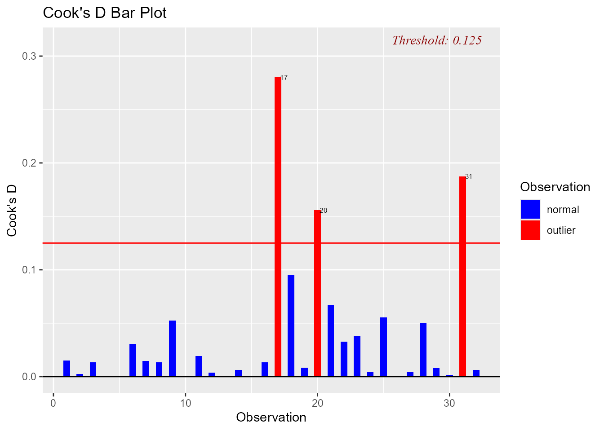
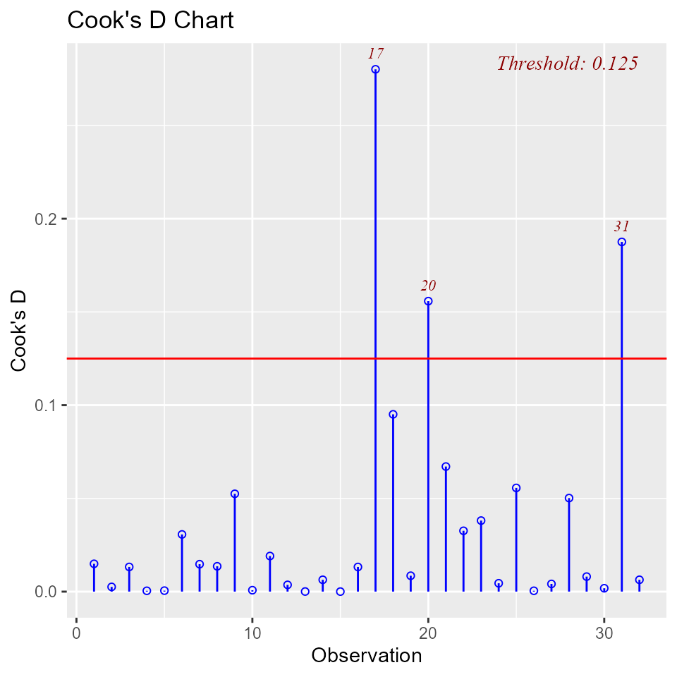
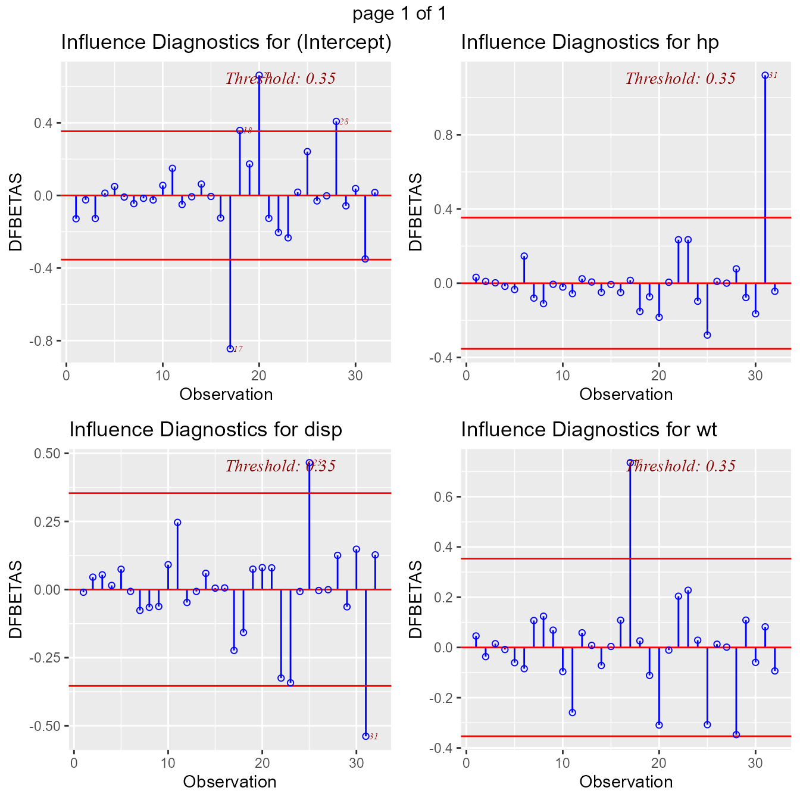
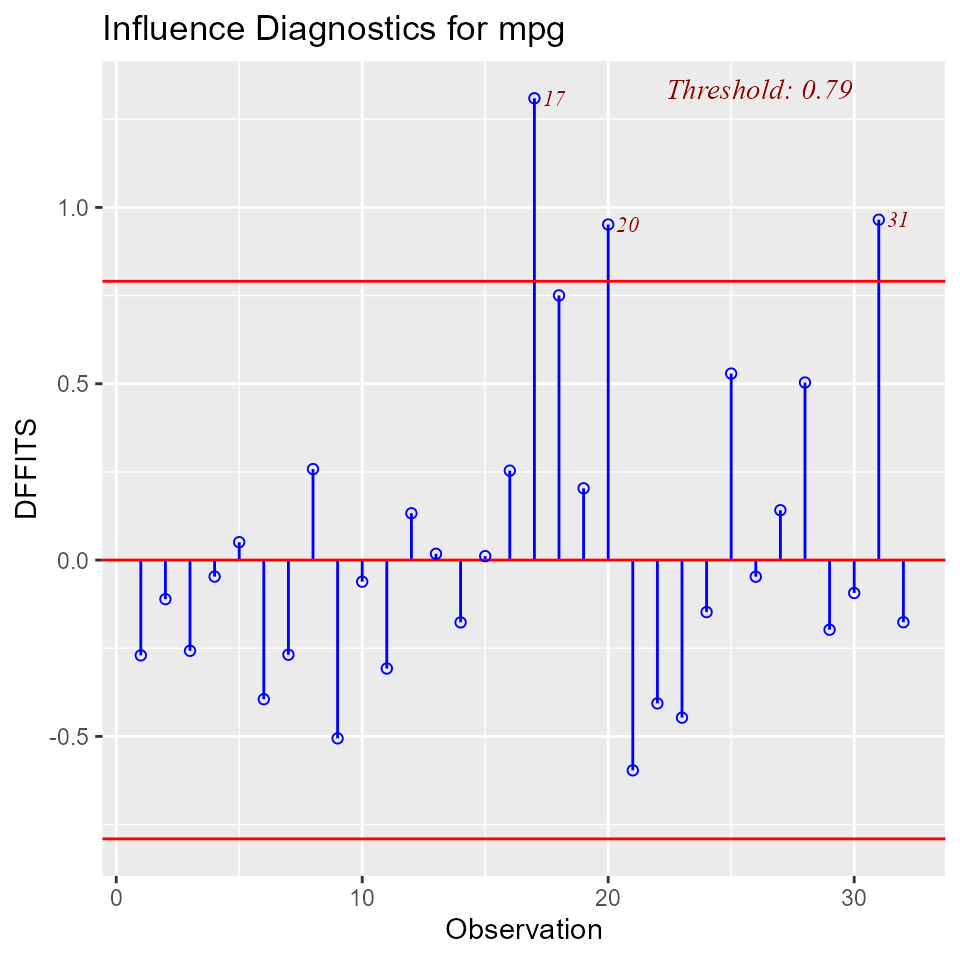
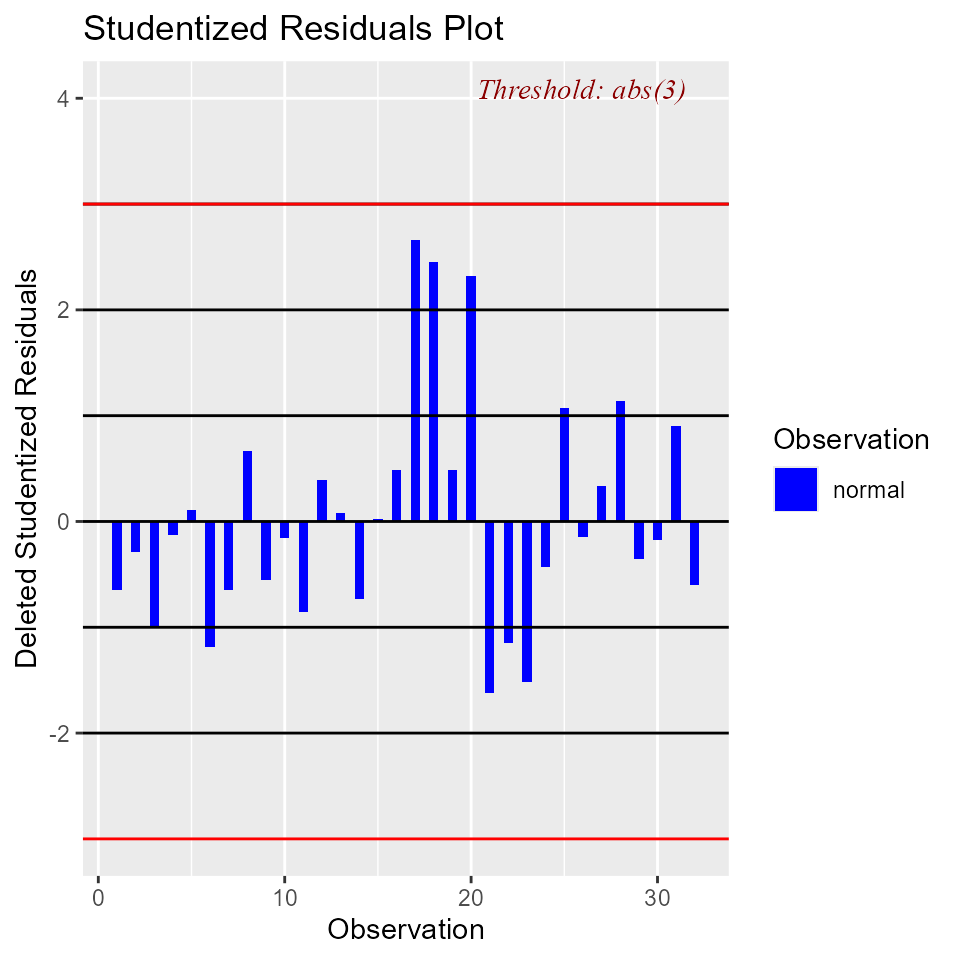
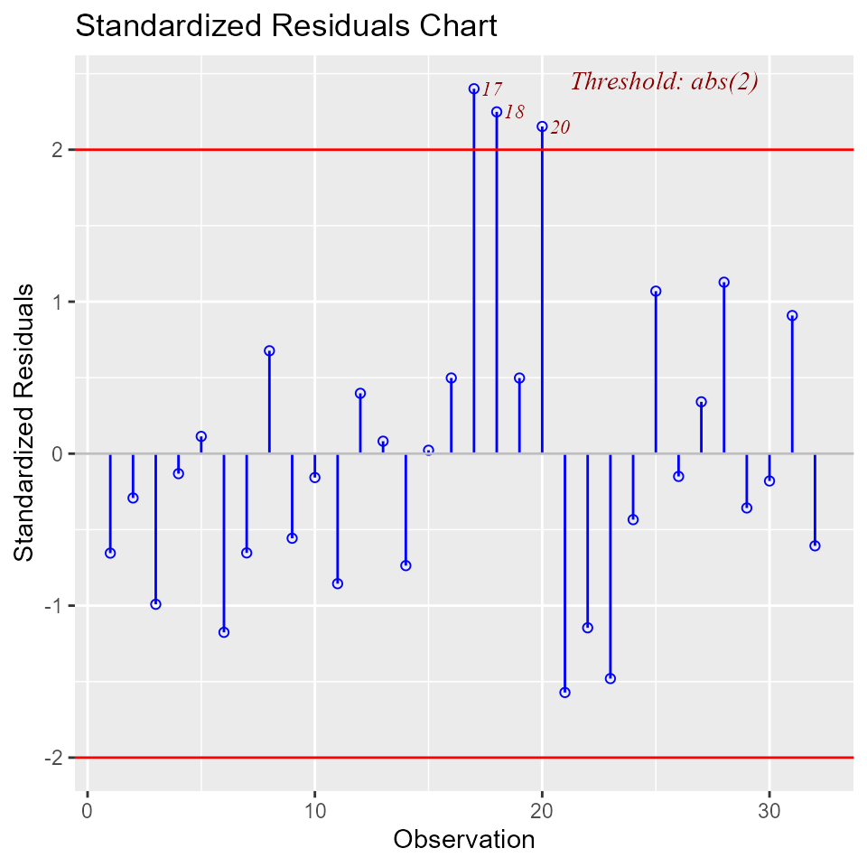
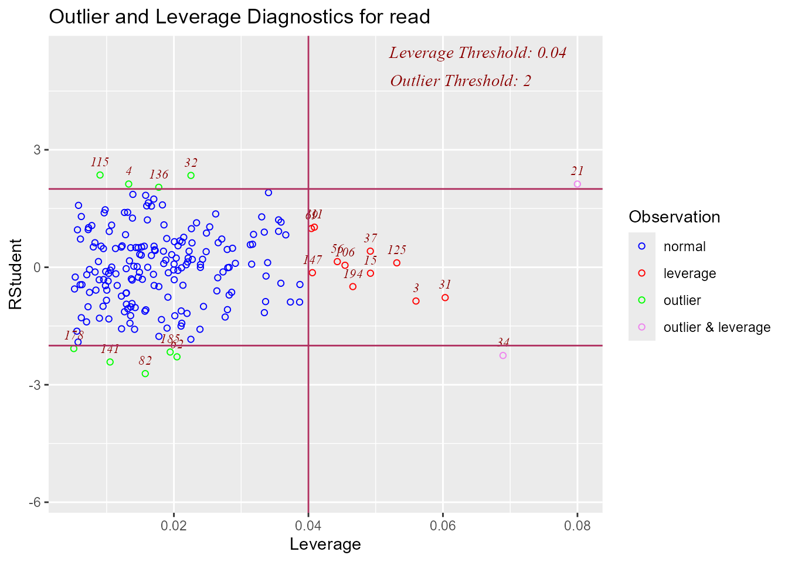
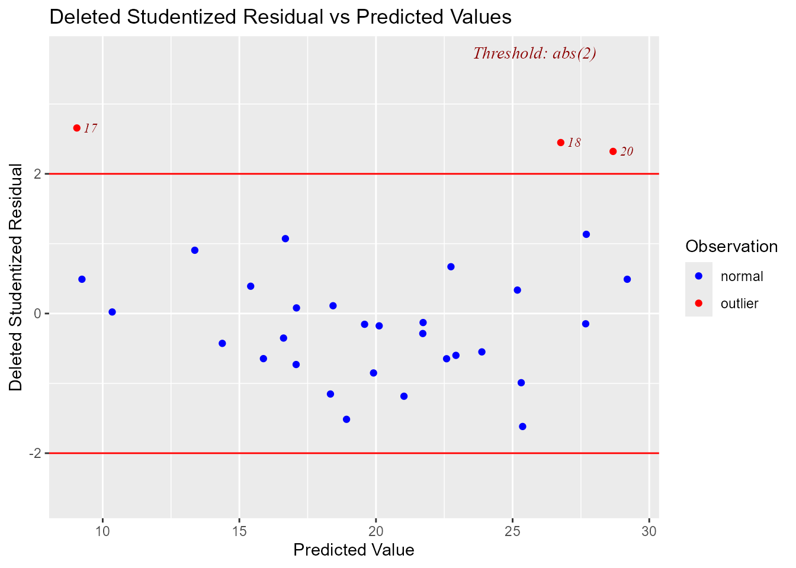
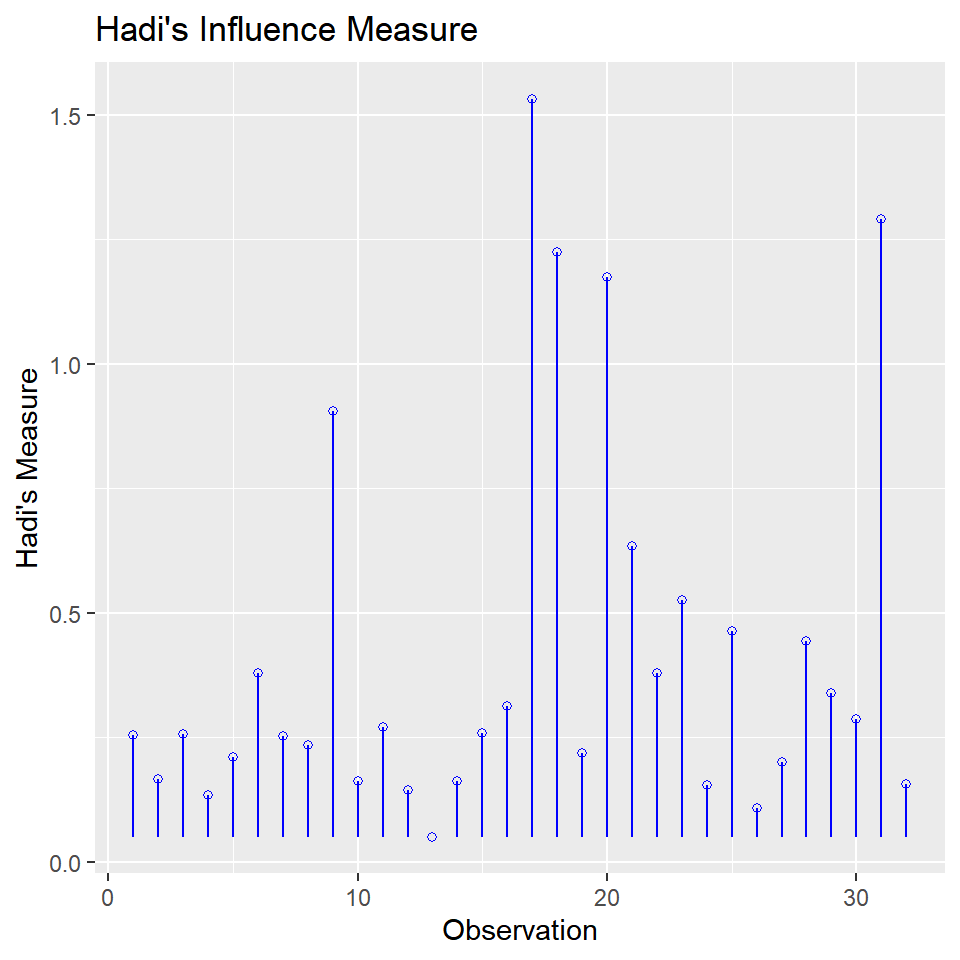
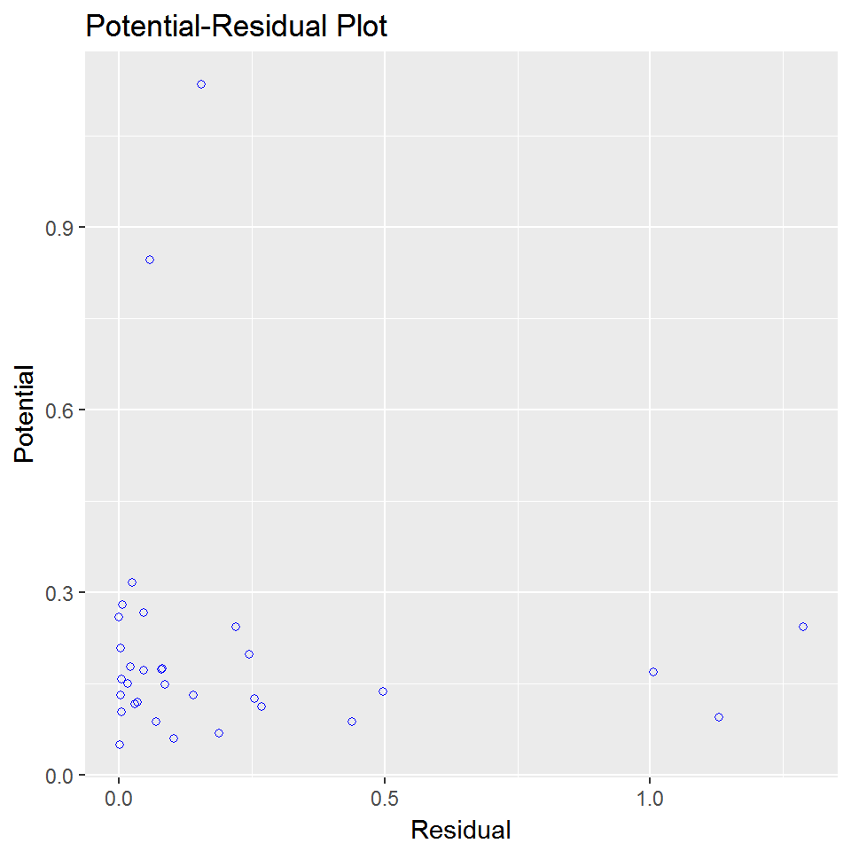

# Measures of Influence

## Introduction

It is possible for a single observation to have a great influence on the
results of a regression analysis. It is therefore important to detect
influential observations and to take them into consideration when
interpreting the results.

**olsrr** offers the following tools to detect influential observations:

- Cook’s D Bar Plot
- Cook’s D Chart
- DFBETAs Panel
- DFFITs Plot
- Studentized Residual Plot
- Standardized Residual Chart
- Studentized Residuals vs Leverage Plot
- Deleted Studentized Residual vs Fitted Values Plot
- Hadi Plot
- Potential Residual Plot

### Cook’s D Bar Plot

Bar Plot of Cook’s distance to detect observations that strongly
influence fitted values of the model. Cook’s distance was introduced by
American statistician R Dennis Cook in 1977. It is used to identify
influential data points. It depends on both the residual and leverage
i.e it takes it account both the **x** value and **y** value of the
observation.

**Steps to compute Cook’s distance:**

- delete observations one at a time.
- refit the regression model on remaining $`(n - 1)`$ observations
- examine how much all of the fitted values change when the ith
  observation is deleted.

A data point having a large cook’s d indicates that the data point
strongly influences the fitted values.

`model`` ``<-`` `[`lm`](https://rdrr.io/r/stats/lm.html)`(``mpg`` ``~`` ``disp`` ``+`` ``hp`` ``+`` ``wt`` ``+`` ``qsec``, data ``=`` ``mtcars``)`` `[`ols_plot_cooksd_bar`](https://olsrr.rsquaredacademy.com/reference/ols_plot_cooksd_bar.md)`(``model``)`



### Cook’s D Chart

Chart of Cook’s distance to detect observations that strongly influence
fitted values of the model.

`model`` ``<-`` `[`lm`](https://rdrr.io/r/stats/lm.html)`(``mpg`` ``~`` ``disp`` ``+`` ``hp`` ``+`` ``wt`` ``+`` ``qsec``, data ``=`` ``mtcars``)`` `[`ols_plot_cooksd_chart`](https://olsrr.rsquaredacademy.com/reference/ols_plot_cooksd_chart.md)`(``model``)`



### DFBETAs Panel

DFBETA measures the difference in each parameter estimate with and
without the influential point. There is a DFBETA for each data point i.e
if there are n observations and k variables, there will be $`n * k`$
DFBETAs. In general, large values of DFBETAS indicate observations that
are influential in estimating a given parameter. Belsley, Kuh, and
Welsch recommend 2 as a general cutoff value to indicate influential
observations and $`\frac{2}{\sqrt{n}}`$ as a size-adjusted cutoff.

`model`` ``<-`` `[`lm`](https://rdrr.io/r/stats/lm.html)`(``mpg`` ``~`` ``disp`` ``+`` ``hp`` ``+`` ``wt``, data ``=`` ``mtcars``)`` `[`ols_plot_dfbetas`](https://olsrr.rsquaredacademy.com/reference/ols_plot_dfbetas.md)`(``model``)`



### DFFITS Plot

Proposed by Welsch and Kuh (1977). It is the scaled difference between
the $`i^{th}`$ fitted value obtained from the full data and the
$`i^{th}`$ fitted value obtained by deleting the $`i^{th}`$ observation.
DFFIT - difference in fits, is used to identify influential data points.
It quantifies the number of standard deviations that the fitted value
changes when the ith data point is omitted.

**Steps to compute DFFITs:**

- delete observations one at a time.
- refit the regression model on remaining observations
- examine how much all of the fitted values change when the ith
  observation is deleted.

An observation is deemed influential if the absolute value of its DFFITS
value is greater than:

``` math
{2}*\sqrt{\frac{(p + 1)}{(n - p - 1)}}
```

A size-adjusted cutoff recommended by Belsley, Kuh, and Welsch is

``` math
{2}*\sqrt{\frac{p}{n}}
```

where n is the number of observations and p is the number of predictors
including intercept.

olsrr uses the size adjusted cutoff by default.

`model`` ``<-`` `[`lm`](https://rdrr.io/r/stats/lm.html)`(``mpg`` ``~`` ``disp`` ``+`` ``hp`` ``+`` ``wt`` ``+`` ``qsec``, data ``=`` ``mtcars``)`` `[`ols_plot_dffits`](https://olsrr.rsquaredacademy.com/reference/ols_plot_dffits.md)`(``model``)`



### Studentized Residual Plot

Plot for detecting outliers. Studentized deleted residuals (or
externally studentized residuals) is the deleted residual divided by its
estimated standard deviation. Studentized residuals are going to be more
effective for detecting outlying Y observations than standardized
residuals. If an observation has an externally studentized residual that
is larger than 3 (in absolute value) we can call it an outlier.

`model`` ``<-`` `[`lm`](https://rdrr.io/r/stats/lm.html)`(``mpg`` ``~`` ``disp`` ``+`` ``hp`` ``+`` ``wt`` ``+`` ``qsec``, data ``=`` ``mtcars``)`` `[`ols_plot_resid_stud`](https://olsrr.rsquaredacademy.com/reference/ols_plot_resid_stud.md)`(``model``)`



### Standardized Residual Chart

Chart for detecting outliers. Standardized residual (internally
studentized) is the residual divided by estimated standard deviation.

`model`` ``<-`` `[`lm`](https://rdrr.io/r/stats/lm.html)`(``mpg`` ``~`` ``disp`` ``+`` ``hp`` ``+`` ``wt`` ``+`` ``qsec``, data ``=`` ``mtcars``)`` `[`ols_plot_resid_stand`](https://olsrr.rsquaredacademy.com/reference/ols_plot_resid_stand.md)`(``model``)`



### Studentized Residuals vs Leverage Plot

Graph for detecting influential observations.

`model`` ``<-`` `[`lm`](https://rdrr.io/r/stats/lm.html)`(``read`` ``~`` ``write`` ``+`` ``math`` ``+`` ``science``, data ``=`` ``hsb``)`` `[`ols_plot_resid_lev`](https://olsrr.rsquaredacademy.com/reference/ols_plot_resid_lev.md)`(``model``)`



### Deleted Studentized Residual vs Fitted Values Plot

Graph for detecting outliers.

`model`` ``<-`` `[`lm`](https://rdrr.io/r/stats/lm.html)`(``mpg`` ``~`` ``disp`` ``+`` ``hp`` ``+`` ``wt`` ``+`` ``qsec``, data ``=`` ``mtcars``)`` `[`ols_plot_resid_stud_fit`](https://olsrr.rsquaredacademy.com/reference/ols_plot_resid_stud_fit.md)`(``model``)`



### Hadi Plot

Hadi’s measure of influence based on the fact that influential
observations can be present in either the response variable or in the
predictors or both. The plot is used to detect influential observations
based on Hadi’s measure.

`model`` ``<-`` `[`lm`](https://rdrr.io/r/stats/lm.html)`(``mpg`` ``~`` ``disp`` ``+`` ``hp`` ``+`` ``wt`` ``+`` ``qsec``, data ``=`` ``mtcars``)`` `[`ols_plot_hadi`](https://olsrr.rsquaredacademy.com/reference/ols_plot_hadi.md)`(``model``)`



### Potential Residual Plot

Plot to aid in classifying unusual observations as high-leverage points,
outliers, or a combination of both.

`model`` ``<-`` `[`lm`](https://rdrr.io/r/stats/lm.html)`(``mpg`` ``~`` ``disp`` ``+`` ``hp`` ``+`` ``wt`` ``+`` ``qsec``, data ``=`` ``mtcars``)`` `[`ols_plot_resid_pot`](https://olsrr.rsquaredacademy.com/reference/ols_plot_resid_pot.md)`(``model``)`


