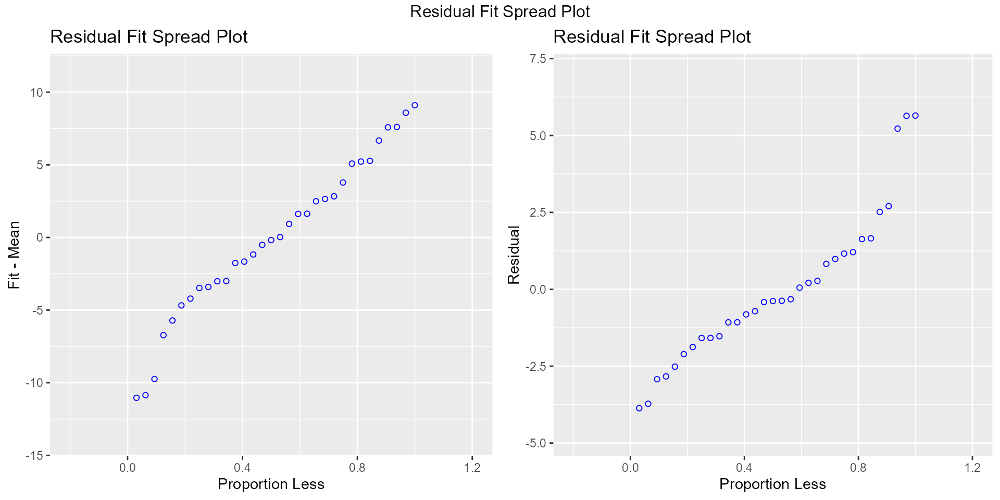
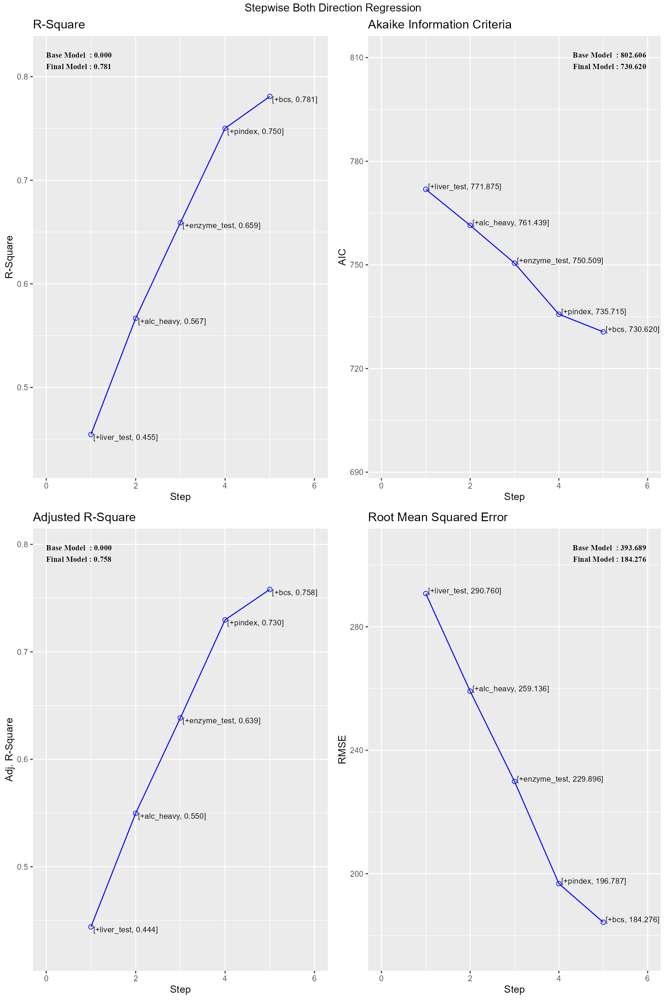
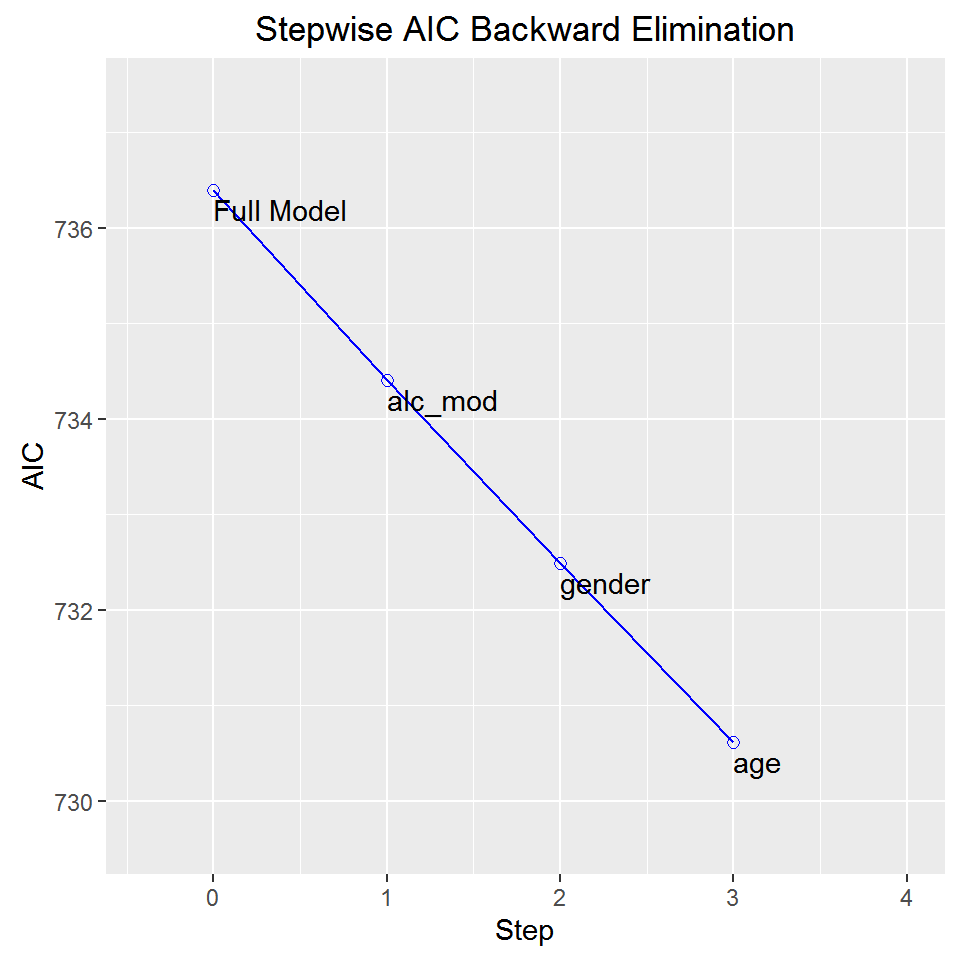

# Introduction to olsrr

## Introduction

The olsrr package provides following tools for teaching and learning OLS
regression using R:

- comprehensive regression output
- residual diagnostics
- measures of influence
- heteroskedasticity tests
- collinearity diagnostics
- model fit assessment
- variable contribution assessment
- variable selection procedures

This document is a quickstart guide to the tools offered by **olsrr**.
Other vignettes provide more details on specific topics:

- Residual Diagnostics: Includes plots to examine residuals to validate
  OLS assumptions

- Variable selection: Differnt variable selection procedures such as all
  possible regression, best subset regression, stepwise regression,
  stepwise forward regression and stepwise backward regression

- Heteroskedasticity: Tests for heteroskedasticity include bartlett
  test, breusch pagan test, score test and f test

- Measures of influence: Includes 10 different plots to detect and
  identify influential observations

- Collinearity diagnostics: VIF, Tolerance and condition indices to
  detect collinearity and plots for assessing mode fit and contributions
  of variables

## Regression

[`ols_regress`](https://olsrr.rsquaredacademy.com/reference/ols_regress.md)`(``mpg`` ``~`` ``disp`` ``+`` ``hp`` ``+`` ``wt`` ``+`` ``qsec``, data ``=`` ``mtcars``)`

    ##                          Model Summary                          
    ## ---------------------------------------------------------------
    ## R                       0.914       RMSE                 2.409 
    ## R-Squared               0.835       MSE                  5.801 
    ## Adj. R-Squared          0.811       Coef. Var           13.051 
    ## Pred R-Squared          0.771       AIC                159.070 
    ## MAE                     1.858       SBC                167.864 
    ## ---------------------------------------------------------------
    ##  RMSE: Root Mean Square Error 
    ##  MSE: Mean Square Error 
    ##  MAE: Mean Absolute Error 
    ##  AIC: Akaike Information Criteria 
    ##  SBC: Schwarz Bayesian Criteria 
    ## 
    ##                                ANOVA                                 
    ## --------------------------------------------------------------------
    ##                 Sum of                                              
    ##                Squares        DF    Mean Square      F         Sig. 
    ## --------------------------------------------------------------------
    ## Regression     940.412         4        235.103    34.195    0.0000 
    ## Residual       185.635        27          6.875                     
    ## Total         1126.047        31                                    
    ## --------------------------------------------------------------------
    ## 
    ##                                   Parameter Estimates                                    
    ## ----------------------------------------------------------------------------------------
    ##       model      Beta    Std. Error    Std. Beta      t        Sig      lower     upper 
    ## ----------------------------------------------------------------------------------------
    ## (Intercept)    27.330         8.639                  3.164    0.004     9.604    45.055 
    ##        disp     0.003         0.011        0.055     0.248    0.806    -0.019     0.025 
    ##          hp    -0.019         0.016       -0.212    -1.196    0.242    -0.051     0.013 
    ##          wt    -4.609         1.266       -0.748    -3.641    0.001    -7.206    -2.012 
    ##        qsec     0.544         0.466        0.161     1.166    0.254    -0.413     1.501 
    ## ----------------------------------------------------------------------------------------

In the presence of interaction terms in the model, the predictors are
scaled and centered before computing the standardized betas.
[`ols_regress()`](https://olsrr.rsquaredacademy.com/reference/ols_regress.md)
will detect interaction terms automatically but in case you have created
a new variable instead of using the inline function `*`, you can
indicate the presence of interaction terms by setting `iterm` to `TRUE`.

## Residual vs Fitted Values Plot

Plot to detect non-linearity, unequal error variances, and outliers.

`model`` ``<-`` `[`lm`](https://rdrr.io/r/stats/lm.html)`(``mpg`` ``~`` ``disp`` ``+`` ``hp`` ``+`` ``wt`` ``+`` ``qsec``, data ``=`` ``mtcars``)`` `[`ols_plot_resid_fit`](https://olsrr.rsquaredacademy.com/reference/ols_plot_resid_fit.md)`(``model``)`

## DFBETAs Panel

DFBETAs measure the difference in each parameter estimate with and
without the influential observation. `dfbetas_panel` creates plots to
detect influential observations using DFBETAs.

`model`` ``<-`` `[`lm`](https://rdrr.io/r/stats/lm.html)`(``mpg`` ``~`` ``disp`` ``+`` ``hp`` ``+`` ``wt``, data ``=`` ``mtcars``)`` `[`ols_plot_dfbetas`](https://olsrr.rsquaredacademy.com/reference/ols_plot_dfbetas.md)`(``model``)`

## Residual Fit Spread Plot

Plot to detect non-linearity, influential observations and outliers.

`model`` ``<-`` `[`lm`](https://rdrr.io/r/stats/lm.html)`(``mpg`` ``~`` ``disp`` ``+`` ``hp`` ``+`` ``wt`` ``+`` ``qsec``, data ``=`` ``mtcars``)`` `[`ols_plot_resid_fit_spread`](https://olsrr.rsquaredacademy.com/reference/ols_plot_resid_fit_spread.md)`(``model``)`

## Breusch Pagan Test

Breusch Pagan test is used to test for herteroskedasticity (non-constant
error variance). It tests whether the variance of the errors from a
regression is dependent on the values of the independent variables. It
is a $`\chi^{2}`$ test.

`model`` ``<-`` `[`lm`](https://rdrr.io/r/stats/lm.html)`(``mpg`` ``~`` ``disp`` ``+`` ``hp`` ``+`` ``wt`` ``+`` ``drat``, data ``=`` ``mtcars``)`` `[`ols_test_breusch_pagan`](https://olsrr.rsquaredacademy.com/reference/ols_test_breusch_pagan.md)`(``model``)`

    ## 
    ##  Breusch Pagan Test for Heteroskedasticity
    ##  -----------------------------------------
    ##  Ho: the variance is constant            
    ##  Ha: the variance is not constant        
    ## 
    ##              Data               
    ##  -------------------------------
    ##  Response : mpg 
    ##  Variables: fitted values of mpg 
    ## 
    ##        Test Summary         
    ##  ---------------------------
    ##  DF            =    1 
    ##  Chi2          =    1.429672 
    ##  Prob > Chi2   =    0.231818

## Collinearity Diagnostics

`model`` ``<-`` `[`lm`](https://rdrr.io/r/stats/lm.html)`(``mpg`` ``~`` ``disp`` ``+`` ``hp`` ``+`` ``wt`` ``+`` ``qsec``, data ``=`` ``mtcars``)`` `[`ols_coll_diag`](https://olsrr.rsquaredacademy.com/reference/ols_coll_diag.md)`(``model``)`

    ## Tolerance and Variance Inflation Factor
    ## ---------------------------------------
    ##   Variables Tolerance      VIF
    ## 1      disp 0.1252279 7.985439
    ## 2        hp 0.1935450 5.166758
    ## 3        wt 0.1445726 6.916942
    ## 4      qsec 0.3191708 3.133119
    ## 
    ## 
    ## Eigenvalue and Condition Index
    ## ------------------------------
    ##    Eigenvalue Condition Index   intercept        disp          hp           wt
    ## 1 4.721487187        1.000000 0.000123237 0.001132468 0.001413094 0.0005253393
    ## 2 0.216562203        4.669260 0.002617424 0.036811051 0.027751289 0.0002096014
    ## 3 0.050416837        9.677242 0.001656551 0.120881424 0.392366164 0.0377028008
    ## 4 0.010104757       21.616057 0.025805998 0.777260487 0.059594623 0.7017528428
    ## 5 0.001429017       57.480524 0.969796790 0.063914571 0.518874831 0.2598094157
    ##           qsec
    ## 1 0.0001277169
    ## 2 0.0046789491
    ## 3 0.0001952599
    ## 4 0.0024577686
    ## 5 0.9925403056

## Stepwise Regression

Build regression model from a set of candidate predictor variables by
entering and removing predictors based on p values, in a stepwise manner
until there is no variable left to enter or remove any more.

### Variable Selection

`# stepwise regression`` ``model`` ``<-`` `[`lm`](https://rdrr.io/r/stats/lm.html)`(``y`` ``~`` ``.``, data ``=`` ``surgical``)`` `[`ols_step_both_p`](https://olsrr.rsquaredacademy.com/reference/ols_step_both_p.md)`(``model``)`

    ## 
    ## 
    ##                                 Stepwise Summary                                
    ## ------------------------------------------------------------------------------
    ## Step    Variable             AIC        SBC       SBIC        R2       Adj. R2 
    ## ------------------------------------------------------------------------------
    ##  0      Base Model         802.606    806.584    646.794    0.00000    0.00000 
    ##  1      liver_test (+)     771.875    777.842    616.009    0.45454    0.44405 
    ##  2      alc_heavy (+)      761.439    769.395    605.506    0.56674    0.54975 
    ##  3      enzyme_test (+)    750.509    760.454    595.297    0.65900    0.63854 
    ##  4      pindex (+)         735.715    747.649    582.943    0.75015    0.72975 
    ##  5      bcs (+)            730.620    744.543    579.638    0.78091    0.75808 
    ## ------------------------------------------------------------------------------
    ## 
    ## Final Model Output 
    ## ------------------
    ## 
    ##                            Model Summary                            
    ## -------------------------------------------------------------------
    ## R                         0.884       RMSE                 184.276 
    ## R-Squared                 0.781       MSE                33957.712 
    ## Adj. R-Squared            0.758       Coef. Var             27.839 
    ## Pred R-Squared            0.700       AIC                  730.620 
    ## MAE                     137.656       SBC                  744.543 
    ## -------------------------------------------------------------------
    ##  RMSE: Root Mean Square Error 
    ##  MSE: Mean Square Error 
    ##  MAE: Mean Absolute Error 
    ##  AIC: Akaike Information Criteria 
    ##  SBC: Schwarz Bayesian Criteria 
    ## 
    ##                                  ANOVA                                  
    ## -----------------------------------------------------------------------
    ##                    Sum of                                              
    ##                   Squares        DF    Mean Square      F         Sig. 
    ## -----------------------------------------------------------------------
    ## Regression    6535804.090         5    1307160.818    34.217    0.0000 
    ## Residual      1833716.447        48      38202.426                     
    ## Total         8369520.537        53                                    
    ## -----------------------------------------------------------------------
    ## 
    ##                                       Parameter Estimates                                        
    ## ------------------------------------------------------------------------------------------------
    ##       model         Beta    Std. Error    Std. Beta      t        Sig         lower       upper 
    ## ------------------------------------------------------------------------------------------------
    ## (Intercept)    -1178.330       208.682                 -5.647    0.000    -1597.914    -758.746 
    ##  liver_test       58.064        40.144        0.156     1.446    0.155      -22.652     138.779 
    ##   alc_heavy      317.848        71.634        0.314     4.437    0.000      173.818     461.878 
    ## enzyme_test        9.748         1.656        0.521     5.887    0.000        6.419      13.077 
    ##      pindex        8.924         1.808        0.380     4.935    0.000        5.288      12.559 
    ##         bcs       59.864        23.060        0.241     2.596    0.012       13.498     106.230 
    ## ------------------------------------------------------------------------------------------------

### Plot

`model`` ``<-`` `[`lm`](https://rdrr.io/r/stats/lm.html)`(``y`` ``~`` ``.``, data ``=`` ``surgical``)`` ``k`` ``<-`` `[`ols_step_both_p`](https://olsrr.rsquaredacademy.com/reference/ols_step_both_p.md)`(``model``)`` `[`plot`](https://rdrr.io/r/graphics/plot.default.html)`(``k``)`

## Stepwise AIC Backward Regression

Build regression model from a set of candidate predictor variables by
removing predictors based on Akaike Information Criteria, in a stepwise
manner until there is no variable left to remove any more.

### Variable Selection

`# stepwise aic backward regression`` ``model`` ``<-`` `[`lm`](https://rdrr.io/r/stats/lm.html)`(``y`` ``~`` ``.``, data ``=`` ``surgical``)`` ``k`` ``<-`` `[`ols_step_backward_aic`](https://olsrr.rsquaredacademy.com/reference/ols_step_backward_aic.md)`(``model``)`` ``k`

    ## 
    ## 
    ##                              Stepwise Summary                              
    ## -------------------------------------------------------------------------
    ## Step    Variable        AIC        SBC       SBIC        R2       Adj. R2 
    ## -------------------------------------------------------------------------
    ##  0      Full Model    736.390    756.280    586.665    0.78184    0.74305 
    ##  1      alc_mod       734.407    752.308    583.884    0.78177    0.74856 
    ##  2      gender        732.494    748.406    581.290    0.78142    0.75351 
    ##  3      age           730.620    744.543    578.844    0.78091    0.75808 
    ## -------------------------------------------------------------------------
    ## 
    ## Final Model Output 
    ## ------------------
    ## 
    ##                            Model Summary                            
    ## -------------------------------------------------------------------
    ## R                         0.884       RMSE                 184.276 
    ## R-Squared                 0.781       MSE                33957.712 
    ## Adj. R-Squared            0.758       Coef. Var             27.839 
    ## Pred R-Squared            0.700       AIC                  730.620 
    ## MAE                     137.656       SBC                  744.543 
    ## -------------------------------------------------------------------
    ##  RMSE: Root Mean Square Error 
    ##  MSE: Mean Square Error 
    ##  MAE: Mean Absolute Error 
    ##  AIC: Akaike Information Criteria 
    ##  SBC: Schwarz Bayesian Criteria 
    ## 
    ##                                  ANOVA                                  
    ## -----------------------------------------------------------------------
    ##                    Sum of                                              
    ##                   Squares        DF    Mean Square      F         Sig. 
    ## -----------------------------------------------------------------------
    ## Regression    6535804.090         5    1307160.818    34.217    0.0000 
    ## Residual      1833716.447        48      38202.426                     
    ## Total         8369520.537        53                                    
    ## -----------------------------------------------------------------------
    ## 
    ##                                       Parameter Estimates                                        
    ## ------------------------------------------------------------------------------------------------
    ##       model         Beta    Std. Error    Std. Beta      t        Sig         lower       upper 
    ## ------------------------------------------------------------------------------------------------
    ## (Intercept)    -1178.330       208.682                 -5.647    0.000    -1597.914    -758.746 
    ##         bcs       59.864        23.060        0.241     2.596    0.012       13.498     106.230 
    ##      pindex        8.924         1.808        0.380     4.935    0.000        5.288      12.559 
    ## enzyme_test        9.748         1.656        0.521     5.887    0.000        6.419      13.077 
    ##  liver_test       58.064        40.144        0.156     1.446    0.155      -22.652     138.779 
    ##   alc_heavy      317.848        71.634        0.314     4.437    0.000      173.818     461.878 
    ## ------------------------------------------------------------------------------------------------

### Plot

`model`` ``<-`` `[`lm`](https://rdrr.io/r/stats/lm.html)`(``y`` ``~`` ``.``, data ``=`` ``surgical``)`` ``k`` ``<-`` `[`ols_step_backward_aic`](https://olsrr.rsquaredacademy.com/reference/ols_step_backward_aic.md)`(``model``)`` `[`plot`](https://rdrr.io/r/graphics/plot.default.html)`(``k``)`

