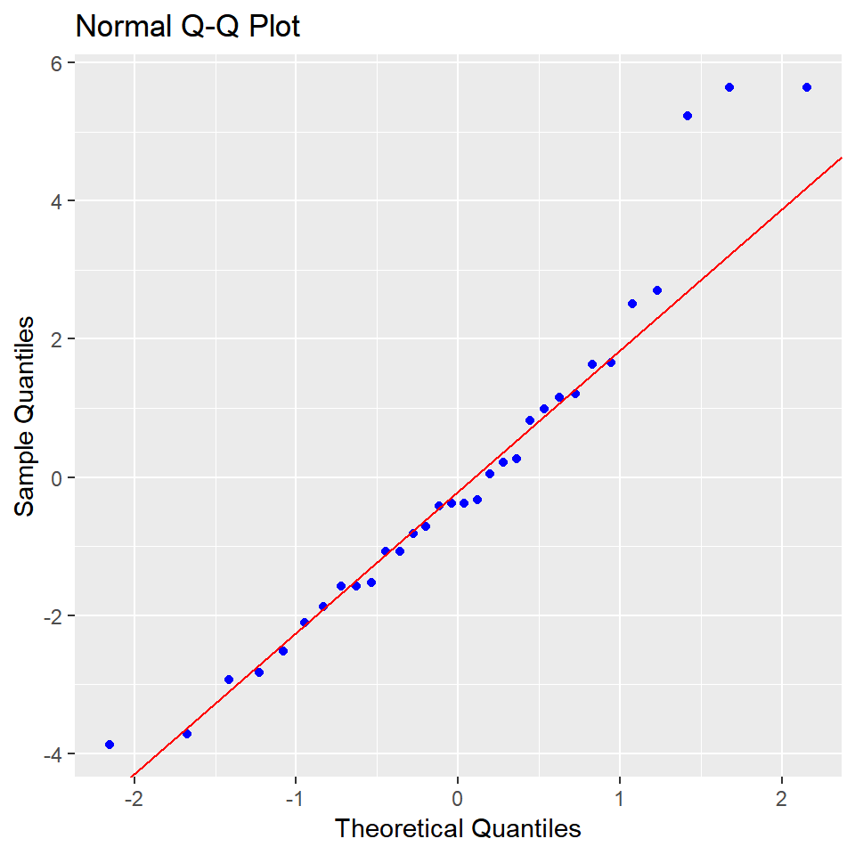
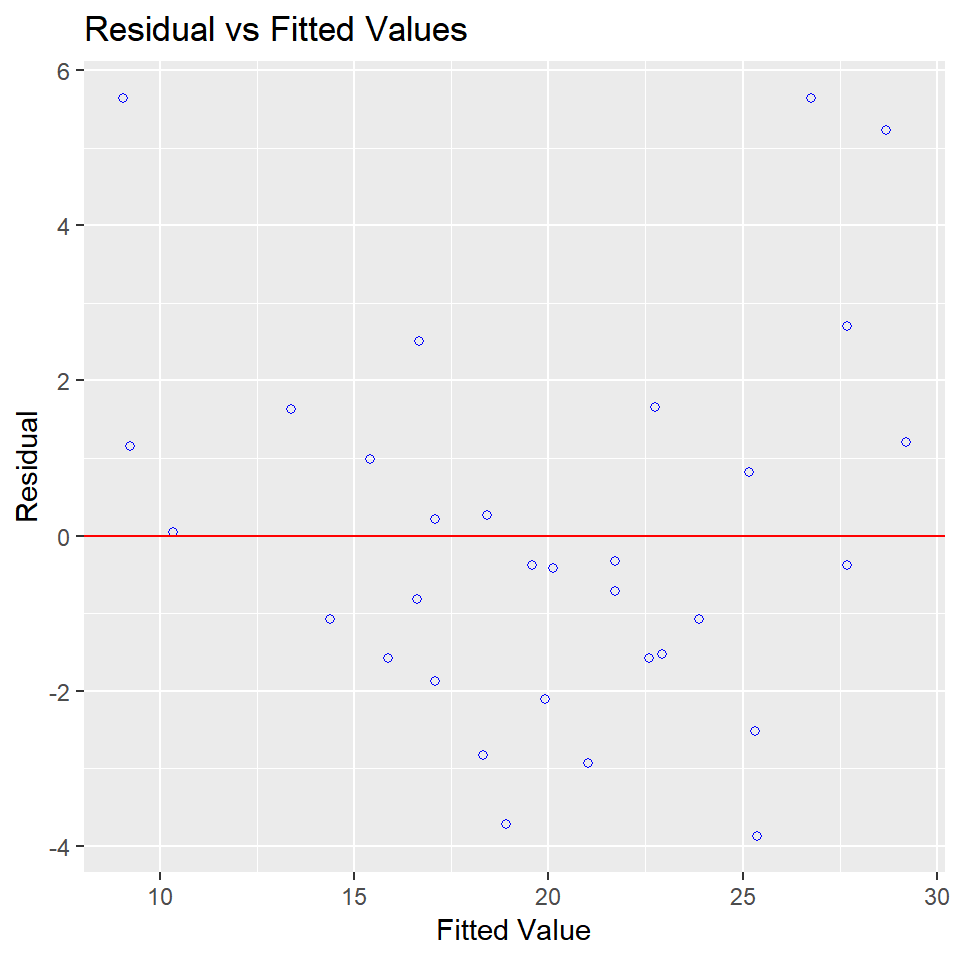
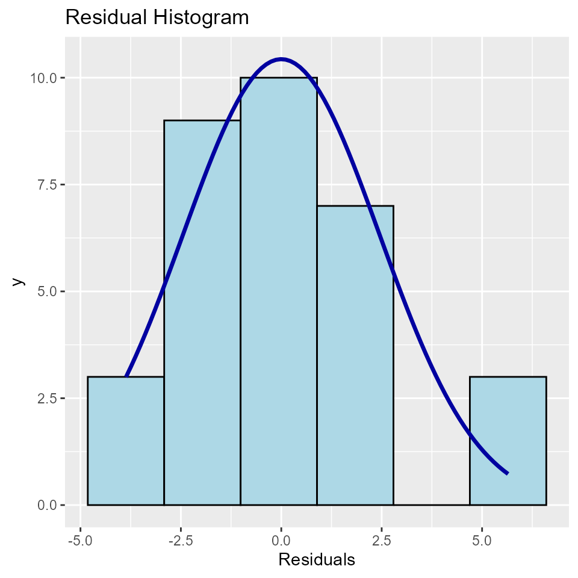

# Residual Diagnostics

## Introduction

olsrr offers tools for detecting violation of standard regression
assumptions. Here we take a look at residual diagnostics. The standard
regression assumptions include the following about residuals/errors:

- The error has a normal distribution (normality assumption).
- The errors have mean zero.
- The errors have same but unknown variance (homoscedasticity
  assumption).
- The error are independent of each other (independent errors
  assumption).

### Residual QQ Plot

Graph for detecting violation of normality assumption.

`model`` ``<-`` `[`lm`](https://rdrr.io/r/stats/lm.html)`(``mpg`` ``~`` ``disp`` ``+`` ``hp`` ``+`` ``wt`` ``+`` ``qsec``, data ``=`` ``mtcars``)`` `[`ols_plot_resid_qq`](https://olsrr.rsquaredacademy.com/reference/ols_plot_resid_qq.md)`(``model``)`

### Residual Normality Test

Test for detecting violation of normality assumption.

`model`` ``<-`` `[`lm`](https://rdrr.io/r/stats/lm.html)`(``mpg`` ``~`` ``disp`` ``+`` ``hp`` ``+`` ``wt`` ``+`` ``qsec``, data ``=`` ``mtcars``)`` `[`ols_test_normality`](https://olsrr.rsquaredacademy.com/reference/ols_test_normality.md)`(``model``)`

    ## -----------------------------------------------
    ##        Test             Statistic       pvalue  
    ## -----------------------------------------------
    ## Shapiro-Wilk              0.9366         0.0600 
    ## Kolmogorov-Smirnov        0.1152         0.7464 
    ## Cramer-von Mises          2.8122         0.0000 
    ## Anderson-Darling          0.5859         0.1188 
    ## -----------------------------------------------

Correlation between observed residuals and expected residuals under
normality.

`model`` ``<-`` `[`lm`](https://rdrr.io/r/stats/lm.html)`(``mpg`` ``~`` ``disp`` ``+`` ``hp`` ``+`` ``wt`` ``+`` ``qsec``, data ``=`` ``mtcars``)`` `[`ols_test_correlation`](https://olsrr.rsquaredacademy.com/reference/ols_test_correlation.md)`(``model``)`

    ## [1] 0.970066

### Residual vs Fitted Values Plot

It is a scatter plot of residuals on the y axis and fitted values on the
x axis to detect non-linearity, unequal error variances, and outliers.

**Characteristics of a well behaved residual vs fitted plot:**

- The residuals spread randomly around the 0 line indicating that the
  relationship is linear.
- The residuals form an approximate horizontal band around the 0 line
  indicating homogeneity of error variance.
- No one residual is visibly away from the random pattern of the
  residuals indicating that there are no outliers.

`model`` ``<-`` `[`lm`](https://rdrr.io/r/stats/lm.html)`(``mpg`` ``~`` ``disp`` ``+`` ``hp`` ``+`` ``wt`` ``+`` ``qsec``, data ``=`` ``mtcars``)`` `[`ols_plot_resid_fit`](https://olsrr.rsquaredacademy.com/reference/ols_plot_resid_fit.md)`(``model``)`

### Residual Histogram

Histogram of residuals for detecting violation of normality assumption.

`model`` ``<-`` `[`lm`](https://rdrr.io/r/stats/lm.html)`(``mpg`` ``~`` ``disp`` ``+`` ``hp`` ``+`` ``wt`` ``+`` ``qsec``, data ``=`` ``mtcars``)`` `[`ols_plot_resid_hist`](https://olsrr.rsquaredacademy.com/reference/ols_plot_resid_hist.md)`(``model``)`

