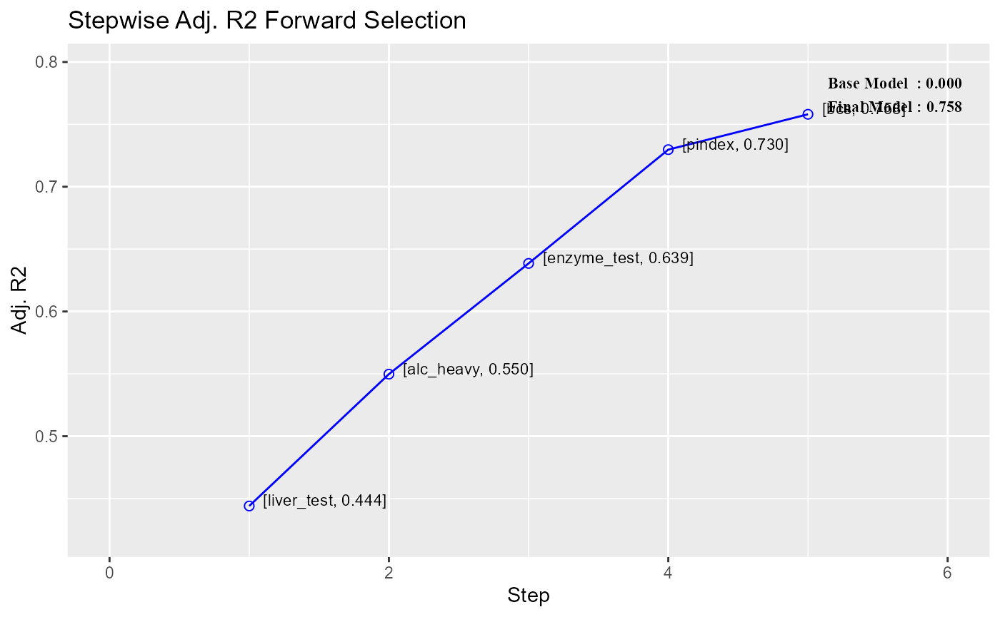

# Variable Selection Methods

## Introduction

Variable selection refers to the process of choosing the most relevant
variables to include in a regression model. They help to improve model
performance and avoid over fitting.

Before we explore stepwise selection methods, let us take a quick look
at all/best subset regression. As they evaluate every possible variable
combination, these methods are computationally intensive and may crash
your system if used with a large set of variables. We have included them
in the package purely for educational purpose.

### All Possible Regression

All subset regression tests all possible subsets of the set of potential
independent variables. If there are K potential independent variables
(besides the constant), then there are $`2^{k}`$ distinct subsets of
them to be tested. For example, if you have 10 candidate independent
variables, the number of subsets to be tested is $`2^{10}`$, which is
1024, and if you have 20 candidate variables, the number is $`2^{20}`$,
which is more than one million.

`model`` ``<-`` `[`lm`](https://rdrr.io/r/stats/lm.html)`(``mpg`` ``~`` ``disp`` ``+`` ``hp`` ``+`` ``wt`` ``+`` ``qsec``, data ``=`` ``mtcars``)`` `[`ols_step_all_possible`](https://olsrr.rsquaredacademy.com/reference/ols_step_all_possible.md)`(``model``)`

    ##    Index N      Predictors  R-Square Adj. R-Square Mallow's Cp
    ## 3      1 1              wt 0.7528328     0.7445939   12.480939
    ## 1      2 1            disp 0.7183433     0.7089548   18.129607
    ## 2      3 1              hp 0.6024373     0.5891853   37.112642
    ## 4      4 1            qsec 0.1752963     0.1478062  107.069616
    ## 8      5 2           hp wt 0.8267855     0.8148396    2.369005
    ## 10     6 2         wt qsec 0.8264161     0.8144448    2.429492
    ## 6      7 2         disp wt 0.7809306     0.7658223    9.879096
    ## 5      8 2         disp hp 0.7482402     0.7308774   15.233115
    ## 7      9 2       disp qsec 0.7215598     0.7023571   19.602810
    ## 9     10 2         hp qsec 0.6368769     0.6118339   33.472150
    ## 14    11 3      hp wt qsec 0.8347678     0.8170643    3.061665
    ## 11    12 3      disp hp wt 0.8268361     0.8082829    4.360702
    ## 13    13 3    disp wt qsec 0.8264170     0.8078189    4.429343
    ## 12    14 3    disp hp qsec 0.7541953     0.7278591   16.257790
    ## 15    15 4 disp hp wt qsec 0.8351443     0.8107212    5.000000

### Best Subset Regression

Select the subset of predictors that do the best at meeting some
well-defined objective criterion, such as having the largest R2 value or
the smallest MSE, Mallow’s Cp or AIC.

`model`` ``<-`` `[`lm`](https://rdrr.io/r/stats/lm.html)`(``mpg`` ``~`` ``disp`` ``+`` ``hp`` ``+`` ``wt`` ``+`` ``qsec``, data ``=`` ``mtcars``)`` `[`ols_step_best_subset`](https://olsrr.rsquaredacademy.com/reference/ols_step_best_subset.md)`(``model``)`

    ##    Best Subsets Regression    
    ## ------------------------------
    ## Model Index    Predictors
    ## ------------------------------
    ##      1         wt              
    ##      2         hp wt           
    ##      3         hp wt qsec      
    ##      4         disp hp wt qsec 
    ## ------------------------------
    ## 
    ##                                                    Subsets Regression Summary                                                    
    ## ---------------------------------------------------------------------------------------------------------------------------------
    ##                        Adj.        Pred                                                                                           
    ## Model    R-Square    R-Square    R-Square     C(p)        AIC        SBIC        SBC         MSEP       FPE       HSP       APC  
    ## ---------------------------------------------------------------------------------------------------------------------------------
    ##   1        0.7528      0.7446      0.7087    12.4809    166.0294    74.2916    170.4266    296.9167    9.8572    0.3199    0.2801 
    ##   2        0.8268      0.8148      0.7811     2.3690    156.6523    66.5755    162.5153    215.5104    7.3563    0.2402    0.2091 
    ##   3        0.8348      0.8171       0.782     3.0617    157.1426    67.7238    164.4713    213.1929    7.4756    0.2461    0.2124 
    ##   4        0.8351      0.8107       0.771     5.0000    159.0696    70.0408    167.8640    220.8882    7.9497    0.2644    0.2259 
    ## ---------------------------------------------------------------------------------------------------------------------------------
    ## AIC: Akaike Information Criteria 
    ##  SBIC: Sawa's Bayesian Information Criteria 
    ##  SBC: Schwarz Bayesian Criteria 
    ##  MSEP: Estimated error of prediction, assuming multivariate normality 
    ##  FPE: Final Prediction Error 
    ##  HSP: Hocking's Sp 
    ##  APC: Amemiya Prediction Criteria

## Stepwise Selection

Stepwise regression is a method of fitting regression models that
involves the iterative selection of independent variables to use in a
model. It can be achieved through forward selection, backward
elimination, or a combination of both methods. The forward selection
approach starts with no variables and adds each new variable
incrementally, testing for statistical significance, while the backward
elimination method begins with a full model and then removes the least
statistically significant variables one at a time.

### Model

We will use the below model throughout this article except in the case
of hierarchical selection. You can learn more about the data
[here](https://olsrr.rsquaredacademy.com/reference/surgical).

`model`` ``<-`` `[`lm`](https://rdrr.io/r/stats/lm.html)`(``y`` ``~`` ``.``, data ``=`` ``surgical``)`` `[`summary`](https://rdrr.io/r/base/summary.html)`(``model``)`

    ## 
    ## Call:
    ## lm(formula = y ~ ., data = surgical)
    ## 
    ## Residuals:
    ##     Min      1Q  Median      3Q     Max 
    ## -285.36 -132.75  -10.00   89.48  790.12 
    ## 
    ## Coefficients:
    ##              Estimate Std. Error t value Pr(>|t|)    
    ## (Intercept) -1148.823    242.328  -4.741 2.17e-05 ***
    ## bcs            62.390     24.470   2.550 0.014258 *  
    ## pindex          8.973      1.874   4.788 1.86e-05 ***
    ## enzyme_test     9.888      1.742   5.677 9.39e-07 ***
    ## liver_test     50.413     44.959   1.121 0.268109    
    ## age            -0.951      2.649  -0.359 0.721231    
    ## gender         15.874     58.475   0.271 0.787269    
    ## alc_mod         7.713     64.956   0.119 0.906007    
    ## alc_heavy     320.697     85.070   3.770 0.000474 ***
    ## ---
    ## Signif. codes:  0 '***' 0.001 '**' 0.01 '*' 0.05 '.' 0.1 ' ' 1
    ## 
    ## Residual standard error: 201.4 on 45 degrees of freedom
    ## Multiple R-squared:  0.7818, Adjusted R-squared:  0.7431 
    ## F-statistic: 20.16 on 8 and 45 DF,  p-value: 1.607e-12

### Model specification

Irrespective of the stepwise method being used, we have to specify the
full model i.e. all the variabels/predictors under consideration as
`olsrr` extracts the candidate variables for selection/elimination from
the model specified.

##### Forward selection

`# stepwise forward regression`` `[`ols_step_forward_p`](https://olsrr.rsquaredacademy.com/reference/ols_step_forward_p.md)`(``model``)`

    ## 
    ## 
    ##                               Stepwise Summary                              
    ## --------------------------------------------------------------------------
    ## Step    Variable         AIC        SBC       SBIC        R2       Adj. R2 
    ## --------------------------------------------------------------------------
    ##  0      Base Model     802.606    806.584    646.794    0.00000    0.00000 
    ##  1      liver_test     771.875    777.842    616.009    0.45454    0.44405 
    ##  2      alc_heavy      761.439    769.395    605.506    0.56674    0.54975 
    ##  3      enzyme_test    750.509    760.454    595.297    0.65900    0.63854 
    ##  4      pindex         735.715    747.649    582.943    0.75015    0.72975 
    ##  5      bcs            730.620    744.543    579.638    0.78091    0.75808 
    ## --------------------------------------------------------------------------
    ## 
    ## Final Model Output 
    ## ------------------
    ## 
    ##                            Model Summary                            
    ## -------------------------------------------------------------------
    ## R                         0.884       RMSE                 184.276 
    ## R-Squared                 0.781       MSE                33957.712 
    ## Adj. R-Squared            0.758       Coef. Var             27.839 
    ## Pred R-Squared            0.700       AIC                  730.620 
    ## MAE                     137.656       SBC                  744.543 
    ## -------------------------------------------------------------------
    ##  RMSE: Root Mean Square Error 
    ##  MSE: Mean Square Error 
    ##  MAE: Mean Absolute Error 
    ##  AIC: Akaike Information Criteria 
    ##  SBC: Schwarz Bayesian Criteria 
    ## 
    ##                                  ANOVA                                  
    ## -----------------------------------------------------------------------
    ##                    Sum of                                              
    ##                   Squares        DF    Mean Square      F         Sig. 
    ## -----------------------------------------------------------------------
    ## Regression    6535804.090         5    1307160.818    34.217    0.0000 
    ## Residual      1833716.447        48      38202.426                     
    ## Total         8369520.537        53                                    
    ## -----------------------------------------------------------------------
    ## 
    ##                                       Parameter Estimates                                        
    ## ------------------------------------------------------------------------------------------------
    ##       model         Beta    Std. Error    Std. Beta      t        Sig         lower       upper 
    ## ------------------------------------------------------------------------------------------------
    ## (Intercept)    -1178.330       208.682                 -5.647    0.000    -1597.914    -758.746 
    ##  liver_test       58.064        40.144        0.156     1.446    0.155      -22.652     138.779 
    ##   alc_heavy      317.848        71.634        0.314     4.437    0.000      173.818     461.878 
    ## enzyme_test        9.748         1.656        0.521     5.887    0.000        6.419      13.077 
    ##      pindex        8.924         1.808        0.380     4.935    0.000        5.288      12.559 
    ##         bcs       59.864        23.060        0.241     2.596    0.012       13.498     106.230 
    ## ------------------------------------------------------------------------------------------------

##### Backward elimination

`# stepwise backward regression`` `[`ols_step_backward_p`](https://olsrr.rsquaredacademy.com/reference/ols_step_backward_p.md)`(``model``)`

    ## 
    ## 
    ##                              Stepwise Summary                              
    ## -------------------------------------------------------------------------
    ## Step    Variable        AIC        SBC       SBIC        R2       Adj. R2 
    ## -------------------------------------------------------------------------
    ##  0      Full Model    736.390    756.280    586.665    0.78184    0.74305 
    ##  1      alc_mod       734.407    752.308    584.276    0.78177    0.74856 
    ##  2      gender        732.494    748.406    581.938    0.78142    0.75351 
    ##  3      age           730.620    744.543    579.638    0.78091    0.75808 
    ## -------------------------------------------------------------------------
    ## 
    ## Final Model Output 
    ## ------------------
    ## 
    ##                            Model Summary                            
    ## -------------------------------------------------------------------
    ## R                         0.884       RMSE                 184.276 
    ## R-Squared                 0.781       MSE                33957.712 
    ## Adj. R-Squared            0.758       Coef. Var             27.839 
    ## Pred R-Squared            0.700       AIC                  730.620 
    ## MAE                     137.656       SBC                  744.543 
    ## -------------------------------------------------------------------
    ##  RMSE: Root Mean Square Error 
    ##  MSE: Mean Square Error 
    ##  MAE: Mean Absolute Error 
    ##  AIC: Akaike Information Criteria 
    ##  SBC: Schwarz Bayesian Criteria 
    ## 
    ##                                  ANOVA                                  
    ## -----------------------------------------------------------------------
    ##                    Sum of                                              
    ##                   Squares        DF    Mean Square      F         Sig. 
    ## -----------------------------------------------------------------------
    ## Regression    6535804.090         5    1307160.818    34.217    0.0000 
    ## Residual      1833716.447        48      38202.426                     
    ## Total         8369520.537        53                                    
    ## -----------------------------------------------------------------------
    ## 
    ##                                       Parameter Estimates                                        
    ## ------------------------------------------------------------------------------------------------
    ##       model         Beta    Std. Error    Std. Beta      t        Sig         lower       upper 
    ## ------------------------------------------------------------------------------------------------
    ## (Intercept)    -1178.330       208.682                 -5.647    0.000    -1597.914    -758.746 
    ##         bcs       59.864        23.060        0.241     2.596    0.012       13.498     106.230 
    ##      pindex        8.924         1.808        0.380     4.935    0.000        5.288      12.559 
    ## enzyme_test        9.748         1.656        0.521     5.887    0.000        6.419      13.077 
    ##  liver_test       58.064        40.144        0.156     1.446    0.155      -22.652     138.779 
    ##   alc_heavy      317.848        71.634        0.314     4.437    0.000      173.818     461.878 
    ## ------------------------------------------------------------------------------------------------

### Criteria

The criteria for selecting variables may be one of the following:

- p value
- akaike information criterion (aic)
- schwarz bayesian criterion (sbc)
- sawa bayesian criterion (sbic)
- r-square
- adjusted r-square

### Include/exclude variables

We can force variables to be included or excluded from the model at all
stages of variable selection. The variables may be specified either by
name or position in the model specified.

##### By name

[`ols_step_forward_p`](https://olsrr.rsquaredacademy.com/reference/ols_step_forward_p.md)`(``model``, include ``=`` `[`c`](https://rdrr.io/r/base/c.html)`(``"age"``, ``"alc_mod"``)``)`

    ## 
    ## 
    ##                               Stepwise Summary                               
    ## ---------------------------------------------------------------------------
    ## Step    Variable         AIC        SBC       SBIC        R2       Adj. R2  
    ## ---------------------------------------------------------------------------
    ##  0      Base Model     804.340    812.295    645.675    0.04110     0.00350 
    ##  1      age            803.834    809.801    646.572    0.01420    -0.00476 
    ##  2      alc_mod        804.340    812.295    645.675    0.04110     0.00350 
    ##  3      liver_test     772.922    782.867    615.246    0.48357     0.45258 
    ##  4      enzyme_test    763.665    775.599    606.382    0.58074     0.54652 
    ##  5      alc_heavy      754.332    768.255    598.224    0.66012     0.62471 
    ##  6      pindex         739.680    755.592    587.108    0.75031     0.71843 
    ## ---------------------------------------------------------------------------
    ## 
    ## Final Model Output 
    ## ------------------
    ## 
    ##                            Model Summary                            
    ## -------------------------------------------------------------------
    ## R                         0.866       RMSE                 196.724 
    ## R-Squared                 0.750       MSE                38700.429 
    ## Adj. R-Squared            0.718       Coef. Var             30.034 
    ## Pred R-Squared            0.649       AIC                  739.680 
    ## MAE                     146.418       SBC                  755.592 
    ## -------------------------------------------------------------------
    ##  RMSE: Root Mean Square Error 
    ##  MSE: Mean Square Error 
    ##  MAE: Mean Absolute Error 
    ##  AIC: Akaike Information Criteria 
    ##  SBC: Schwarz Bayesian Criteria 
    ## 
    ##                                  ANOVA                                  
    ## -----------------------------------------------------------------------
    ##                    Sum of                                              
    ##                   Squares        DF    Mean Square      F         Sig. 
    ## -----------------------------------------------------------------------
    ## Regression    6279697.346         6    1046616.224    23.538    0.0000 
    ## Residual      2089823.191        47      44464.323                     
    ## Total         8369520.537        53                                    
    ## -----------------------------------------------------------------------
    ## 
    ##                                       Parameter Estimates                                       
    ## -----------------------------------------------------------------------------------------------
    ##       model        Beta    Std. Error    Std. Beta      t        Sig         lower       upper 
    ## -----------------------------------------------------------------------------------------------
    ## (Intercept)    -814.092       213.222                 -3.818    0.000    -1243.041    -385.144 
    ##         age       0.458         2.706        0.013     0.169    0.866       -4.985       5.902 
    ##     alc_mod       1.088        67.941        0.001     0.016    0.987     -135.591     137.768 
    ##  liver_test     126.675        33.832        0.341     3.744    0.000       58.613     194.737 
    ## enzyme_test       7.523         1.543        0.402     4.874    0.000        4.418      10.628 
    ##   alc_heavy     361.751        87.140        0.357     4.151    0.000      186.448     537.053 
    ##      pindex       7.862         1.908        0.334     4.120    0.000        4.023      11.700 
    ## -----------------------------------------------------------------------------------------------

##### By index

[`ols_step_forward_p`](https://olsrr.rsquaredacademy.com/reference/ols_step_forward_p.md)`(``model``, include ``=`` `[`c`](https://rdrr.io/r/base/c.html)`(``5``, ``7``)``)`

    ## 
    ## 
    ##                               Stepwise Summary                               
    ## ---------------------------------------------------------------------------
    ## Step    Variable         AIC        SBC       SBIC        R2       Adj. R2  
    ## ---------------------------------------------------------------------------
    ##  0      Base Model     804.340    812.295    645.675    0.04110     0.00350 
    ##  1      age            803.834    809.801    646.572    0.01420    -0.00476 
    ##  2      alc_mod        804.340    812.295    645.675    0.04110     0.00350 
    ##  3      liver_test     772.922    782.867    615.246    0.48357     0.45258 
    ##  4      enzyme_test    763.665    775.599    606.382    0.58074     0.54652 
    ##  5      alc_heavy      754.332    768.255    598.224    0.66012     0.62471 
    ##  6      pindex         739.680    755.592    587.108    0.75031     0.71843 
    ## ---------------------------------------------------------------------------
    ## 
    ## Final Model Output 
    ## ------------------
    ## 
    ##                            Model Summary                            
    ## -------------------------------------------------------------------
    ## R                         0.866       RMSE                 196.724 
    ## R-Squared                 0.750       MSE                38700.429 
    ## Adj. R-Squared            0.718       Coef. Var             30.034 
    ## Pred R-Squared            0.649       AIC                  739.680 
    ## MAE                     146.418       SBC                  755.592 
    ## -------------------------------------------------------------------
    ##  RMSE: Root Mean Square Error 
    ##  MSE: Mean Square Error 
    ##  MAE: Mean Absolute Error 
    ##  AIC: Akaike Information Criteria 
    ##  SBC: Schwarz Bayesian Criteria 
    ## 
    ##                                  ANOVA                                  
    ## -----------------------------------------------------------------------
    ##                    Sum of                                              
    ##                   Squares        DF    Mean Square      F         Sig. 
    ## -----------------------------------------------------------------------
    ## Regression    6279697.346         6    1046616.224    23.538    0.0000 
    ## Residual      2089823.191        47      44464.323                     
    ## Total         8369520.537        53                                    
    ## -----------------------------------------------------------------------
    ## 
    ##                                       Parameter Estimates                                       
    ## -----------------------------------------------------------------------------------------------
    ##       model        Beta    Std. Error    Std. Beta      t        Sig         lower       upper 
    ## -----------------------------------------------------------------------------------------------
    ## (Intercept)    -814.092       213.222                 -3.818    0.000    -1243.041    -385.144 
    ##         age       0.458         2.706        0.013     0.169    0.866       -4.985       5.902 
    ##     alc_mod       1.088        67.941        0.001     0.016    0.987     -135.591     137.768 
    ##  liver_test     126.675        33.832        0.341     3.744    0.000       58.613     194.737 
    ## enzyme_test       7.523         1.543        0.402     4.874    0.000        4.418      10.628 
    ##   alc_heavy     361.751        87.140        0.357     4.151    0.000      186.448     537.053 
    ##      pindex       7.862         1.908        0.334     4.120    0.000        4.023      11.700 
    ## -----------------------------------------------------------------------------------------------

### Standardized output

All stepwise selection methods display standard output which includes:

- selection summary
- model summary
- ANOVA
- parameter estimates

`# adjusted r-square `` `[`ols_step_forward_adj_r2`](https://olsrr.rsquaredacademy.com/reference/ols_step_forward_adj_r2.md)`(``model``)`

    ## 
    ## 
    ##                               Stepwise Summary                              
    ## --------------------------------------------------------------------------
    ## Step    Variable         AIC        SBC       SBIC        R2       Adj. R2 
    ## --------------------------------------------------------------------------
    ##  0      Base Model     802.606    806.584    646.794    0.00000    0.00000 
    ##  1      liver_test     771.875    777.842    616.009    0.45454    0.44405 
    ##  2      alc_heavy      761.439    769.395    605.506    0.56674    0.54975 
    ##  3      enzyme_test    750.509    760.454    595.297    0.65900    0.63854 
    ##  4      pindex         735.715    747.649    582.943    0.75015    0.72975 
    ##  5      bcs            730.620    744.543    579.638    0.78091    0.75808 
    ## --------------------------------------------------------------------------
    ## 
    ## Final Model Output 
    ## ------------------
    ## 
    ##                            Model Summary                            
    ## -------------------------------------------------------------------
    ## R                         0.884       RMSE                 184.276 
    ## R-Squared                 0.781       MSE                33957.712 
    ## Adj. R-Squared            0.758       Coef. Var             27.839 
    ## Pred R-Squared            0.700       AIC                  730.620 
    ## MAE                     137.656       SBC                  744.543 
    ## -------------------------------------------------------------------
    ##  RMSE: Root Mean Square Error 
    ##  MSE: Mean Square Error 
    ##  MAE: Mean Absolute Error 
    ##  AIC: Akaike Information Criteria 
    ##  SBC: Schwarz Bayesian Criteria 
    ## 
    ##                                  ANOVA                                  
    ## -----------------------------------------------------------------------
    ##                    Sum of                                              
    ##                   Squares        DF    Mean Square      F         Sig. 
    ## -----------------------------------------------------------------------
    ## Regression    6535804.090         5    1307160.818    34.217    0.0000 
    ## Residual      1833716.447        48      38202.426                     
    ## Total         8369520.537        53                                    
    ## -----------------------------------------------------------------------
    ## 
    ##                                       Parameter Estimates                                        
    ## ------------------------------------------------------------------------------------------------
    ##       model         Beta    Std. Error    Std. Beta      t        Sig         lower       upper 
    ## ------------------------------------------------------------------------------------------------
    ## (Intercept)    -1178.330       208.682                 -5.647    0.000    -1597.914    -758.746 
    ##  liver_test       58.064        40.144        0.156     1.446    0.155      -22.652     138.779 
    ##   alc_heavy      317.848        71.634        0.314     4.437    0.000      173.818     461.878 
    ## enzyme_test        9.748         1.656        0.521     5.887    0.000        6.419      13.077 
    ##      pindex        8.924         1.808        0.380     4.935    0.000        5.288      12.559 
    ##         bcs       59.864        23.060        0.241     2.596    0.012       13.498     106.230 
    ## ------------------------------------------------------------------------------------------------

### Visualization

Use the [`plot()`](https://rdrr.io/r/graphics/plot.default.html) method
to visualize variable selection. It will display how the variable
selection criteria changes at each step of the selection process along
with the variable selected.

`# adjusted r-square `` ``k`` ``<-`` `[`ols_step_forward_adj_r2`](https://olsrr.rsquaredacademy.com/reference/ols_step_forward_adj_r2.md)`(``model``)`` `[`plot`](https://rdrr.io/r/graphics/plot.default.html)`(``k``)`

### Verbose output

To view the detailed regression output at each stage of variable
selection/elimination, set `details` to `TRUE`. It will display the
following information at each step:

- step number
- variable selected/eliminated
- model
- value of the criteria at that stage

`# adjusted r-square `` `[`ols_step_forward_adj_r2`](https://olsrr.rsquaredacademy.com/reference/ols_step_forward_adj_r2.md)`(``model``, details ``=`` ``TRUE``)`

    ## Forward Selection Method 
    ## ------------------------
    ## 
    ## Candidate Terms: 
    ## 
    ## 1. bcs 
    ## 2. pindex 
    ## 3. enzyme_test 
    ## 4. liver_test 
    ## 5. age 
    ## 6. gender 
    ## 7. alc_mod 
    ## 8. alc_heavy 
    ## 
    ## 
    ## Step     => 0 
    ## Model    => y ~ 1 
    ## Adj. R2  => 0 
    ## 
    ## Initiating stepwise selection... 
    ## 
    ##                        Table: Adding New Variables                        
    ## -------------------------------------------------------------------------
    ## Predictor      DF      AIC        SBC       SBIC        R2       Adj. R2  
    ## -------------------------------------------------------------------------
    ## liver_test      1    771.875    777.842    616.009    0.45454     0.44405 
    ## enzyme_test     1    782.629    788.596    626.220    0.33435     0.32154 
    ## pindex          1    794.100    800.067    637.196    0.17680     0.16097 
    ## alc_heavy       1    794.301    800.268    637.389    0.17373     0.15784 
    ## bcs             1    797.697    803.664    640.655    0.12010     0.10318 
    ## alc_mod         1    802.828    808.795    645.601    0.03239     0.01378 
    ## gender          1    802.956    808.923    645.725    0.03009     0.01143 
    ## age             1    803.834    809.801    646.572    0.01420    -0.00476 
    ## -------------------------------------------------------------------------
    ## 
    ## Step     => 1 
    ## Added    => liver_test 
    ## Model    => y ~ liver_test 
    ## Adj. R2  => 0.44405 
    ## 
    ##                       Table: Adding New Variables                        
    ## ------------------------------------------------------------------------
    ## Predictor      DF      AIC        SBC       SBIC        R2       Adj. R2 
    ## ------------------------------------------------------------------------
    ## alc_heavy       1    761.439    769.395    605.506    0.56674    0.54975 
    ## enzyme_test     1    762.077    770.033    606.090    0.56159    0.54440 
    ## pindex          1    770.387    778.343    613.737    0.48866    0.46861 
    ## alc_mod         1    771.141    779.097    614.435    0.48147    0.46113 
    ## gender          1    773.802    781.758    616.901    0.45528    0.43391 
    ## age             1    773.831    781.787    616.928    0.45498    0.43361 
    ## bcs             1    773.867    781.823    616.961    0.45462    0.43323 
    ## ------------------------------------------------------------------------
    ## 
    ## Step     => 2 
    ## Added    => alc_heavy 
    ## Model    => y ~ liver_test + alc_heavy 
    ## Adj. R2  => 0.54975 
    ## 
    ##                       Table: Adding New Variables                        
    ## ------------------------------------------------------------------------
    ## Predictor      DF      AIC        SBC       SBIC        R2       Adj. R2 
    ## ------------------------------------------------------------------------
    ## enzyme_test     1    750.509    760.454    595.297    0.65900    0.63854 
    ## pindex          1    756.125    766.070    600.225    0.62163    0.59892 
    ## bcs             1    763.063    773.008    606.379    0.56975    0.54394 
    ## age             1    763.110    773.055    606.421    0.56938    0.54354 
    ## alc_mod         1    763.428    773.373    606.704    0.56683    0.54084 
    ## gender          1    763.433    773.378    606.709    0.56679    0.54080 
    ## ------------------------------------------------------------------------
    ## 
    ## Step     => 3 
    ## Added    => enzyme_test 
    ## Model    => y ~ liver_test + alc_heavy + enzyme_test 
    ## Adj. R2  => 0.63854 
    ## 
    ##                      Table: Adding New Variables                       
    ## ----------------------------------------------------------------------
    ## Predictor    DF      AIC        SBC       SBIC        R2       Adj. R2 
    ## ----------------------------------------------------------------------
    ## pindex        1    735.715    747.649    582.943    0.75015    0.72975 
    ## bcs           1    750.782    762.716    595.377    0.66973    0.64277 
    ## alc_mod       1    752.403    764.337    596.743    0.65967    0.63189 
    ## age           1    752.416    764.350    596.755    0.65959    0.63180 
    ## gender        1    752.509    764.443    596.833    0.65900    0.63116 
    ## ----------------------------------------------------------------------
    ## 
    ## Step     => 4 
    ## Added    => pindex 
    ## Model    => y ~ liver_test + alc_heavy + enzyme_test + pindex 
    ## Adj. R2  => 0.72975 
    ## 
    ##                      Table: Adding New Variables                       
    ## ----------------------------------------------------------------------
    ## Predictor    DF      AIC        SBC       SBIC        R2       Adj. R2 
    ## ----------------------------------------------------------------------
    ## bcs           1    730.620    744.543    579.638    0.78091    0.75808 
    ## age           1    737.680    751.603    585.012    0.75030    0.72429 
    ## gender        1    737.712    751.635    585.036    0.75016    0.72413 
    ## alc_mod       1    737.713    751.636    585.037    0.75015    0.72413 
    ## ----------------------------------------------------------------------
    ## 
    ## Step     => 5 
    ## Added    => bcs 
    ## Model    => y ~ liver_test + alc_heavy + enzyme_test + pindex + bcs 
    ## Adj. R2  => 0.75808 
    ## 
    ##                      Table: Adding New Variables                       
    ## ----------------------------------------------------------------------
    ## Predictor    DF      AIC        SBC       SBIC        R2       Adj. R2 
    ## ----------------------------------------------------------------------
    ## age           1    732.494    748.406    581.938    0.78142    0.75351 
    ## gender        1    732.551    748.463    581.978    0.78119    0.75325 
    ## alc_mod       1    732.614    748.526    582.023    0.78093    0.75297 
    ## ----------------------------------------------------------------------
    ## 
    ## 
    ## No more variables to be added.
    ## 
    ## Variables Selected: 
    ## 
    ## => liver_test 
    ## => alc_heavy 
    ## => enzyme_test 
    ## => pindex 
    ## => bcs

    ## 
    ## 
    ##                               Stepwise Summary                              
    ## --------------------------------------------------------------------------
    ## Step    Variable         AIC        SBC       SBIC        R2       Adj. R2 
    ## --------------------------------------------------------------------------
    ##  0      Base Model     802.606    806.584    646.794    0.00000    0.00000 
    ##  1      liver_test     771.875    777.842    616.009    0.45454    0.44405 
    ##  2      alc_heavy      761.439    769.395    605.506    0.56674    0.54975 
    ##  3      enzyme_test    750.509    760.454    595.297    0.65900    0.63854 
    ##  4      pindex         735.715    747.649    582.943    0.75015    0.72975 
    ##  5      bcs            730.620    744.543    579.638    0.78091    0.75808 
    ## --------------------------------------------------------------------------
    ## 
    ## Final Model Output 
    ## ------------------
    ## 
    ##                            Model Summary                            
    ## -------------------------------------------------------------------
    ## R                         0.884       RMSE                 184.276 
    ## R-Squared                 0.781       MSE                33957.712 
    ## Adj. R-Squared            0.758       Coef. Var             27.839 
    ## Pred R-Squared            0.700       AIC                  730.620 
    ## MAE                     137.656       SBC                  744.543 
    ## -------------------------------------------------------------------
    ##  RMSE: Root Mean Square Error 
    ##  MSE: Mean Square Error 
    ##  MAE: Mean Absolute Error 
    ##  AIC: Akaike Information Criteria 
    ##  SBC: Schwarz Bayesian Criteria 
    ## 
    ##                                  ANOVA                                  
    ## -----------------------------------------------------------------------
    ##                    Sum of                                              
    ##                   Squares        DF    Mean Square      F         Sig. 
    ## -----------------------------------------------------------------------
    ## Regression    6535804.090         5    1307160.818    34.217    0.0000 
    ## Residual      1833716.447        48      38202.426                     
    ## Total         8369520.537        53                                    
    ## -----------------------------------------------------------------------
    ## 
    ##                                       Parameter Estimates                                        
    ## ------------------------------------------------------------------------------------------------
    ##       model         Beta    Std. Error    Std. Beta      t        Sig         lower       upper 
    ## ------------------------------------------------------------------------------------------------
    ## (Intercept)    -1178.330       208.682                 -5.647    0.000    -1597.914    -758.746 
    ##  liver_test       58.064        40.144        0.156     1.446    0.155      -22.652     138.779 
    ##   alc_heavy      317.848        71.634        0.314     4.437    0.000      173.818     461.878 
    ## enzyme_test        9.748         1.656        0.521     5.887    0.000        6.419      13.077 
    ##      pindex        8.924         1.808        0.380     4.935    0.000        5.288      12.559 
    ##         bcs       59.864        23.060        0.241     2.596    0.012       13.498     106.230 
    ## ------------------------------------------------------------------------------------------------

### Progress

To view the progress in the variable selection procedure, set `progress`
to `TRUE`. It will display the variable being selected/eliminated at
each step until there are no more candidate variables left.

`# adjusted r-square `` `[`ols_step_forward_adj_r2`](https://olsrr.rsquaredacademy.com/reference/ols_step_forward_adj_r2.md)`(``model``, progress ``=`` ``TRUE``)`

    ## Forward Selection Method 
    ## ------------------------
    ## 
    ## Candidate Terms: 
    ## 
    ## 1. bcs 
    ## 2. pindex 
    ## 3. enzyme_test 
    ## 4. liver_test 
    ## 5. age 
    ## 6. gender 
    ## 7. alc_mod 
    ## 8. alc_heavy 
    ## 
    ## 
    ## Variables Entered: 
    ## 
    ## => liver_test 
    ## => alc_heavy 
    ## => enzyme_test 
    ## => pindex 
    ## => bcs 
    ## 
    ## No more variables to be added.

    ## 
    ## 
    ##                               Stepwise Summary                              
    ## --------------------------------------------------------------------------
    ## Step    Variable         AIC        SBC       SBIC        R2       Adj. R2 
    ## --------------------------------------------------------------------------
    ##  0      Base Model     802.606    806.584    646.794    0.00000    0.00000 
    ##  1      liver_test     771.875    777.842    616.009    0.45454    0.44405 
    ##  2      alc_heavy      761.439    769.395    605.506    0.56674    0.54975 
    ##  3      enzyme_test    750.509    760.454    595.297    0.65900    0.63854 
    ##  4      pindex         735.715    747.649    582.943    0.75015    0.72975 
    ##  5      bcs            730.620    744.543    579.638    0.78091    0.75808 
    ## --------------------------------------------------------------------------
    ## 
    ## Final Model Output 
    ## ------------------
    ## 
    ##                            Model Summary                            
    ## -------------------------------------------------------------------
    ## R                         0.884       RMSE                 184.276 
    ## R-Squared                 0.781       MSE                33957.712 
    ## Adj. R-Squared            0.758       Coef. Var             27.839 
    ## Pred R-Squared            0.700       AIC                  730.620 
    ## MAE                     137.656       SBC                  744.543 
    ## -------------------------------------------------------------------
    ##  RMSE: Root Mean Square Error 
    ##  MSE: Mean Square Error 
    ##  MAE: Mean Absolute Error 
    ##  AIC: Akaike Information Criteria 
    ##  SBC: Schwarz Bayesian Criteria 
    ## 
    ##                                  ANOVA                                  
    ## -----------------------------------------------------------------------
    ##                    Sum of                                              
    ##                   Squares        DF    Mean Square      F         Sig. 
    ## -----------------------------------------------------------------------
    ## Regression    6535804.090         5    1307160.818    34.217    0.0000 
    ## Residual      1833716.447        48      38202.426                     
    ## Total         8369520.537        53                                    
    ## -----------------------------------------------------------------------
    ## 
    ##                                       Parameter Estimates                                        
    ## ------------------------------------------------------------------------------------------------
    ##       model         Beta    Std. Error    Std. Beta      t        Sig         lower       upper 
    ## ------------------------------------------------------------------------------------------------
    ## (Intercept)    -1178.330       208.682                 -5.647    0.000    -1597.914    -758.746 
    ##  liver_test       58.064        40.144        0.156     1.446    0.155      -22.652     138.779 
    ##   alc_heavy      317.848        71.634        0.314     4.437    0.000      173.818     461.878 
    ## enzyme_test        9.748         1.656        0.521     5.887    0.000        6.419      13.077 
    ##      pindex        8.924         1.808        0.380     4.935    0.000        5.288      12.559 
    ##         bcs       59.864        23.060        0.241     2.596    0.012       13.498     106.230 
    ## ------------------------------------------------------------------------------------------------

### Hierarchical selection

When using `p` values as the criterion for selecting/eliminating
variables, we can enable hierarchical selection. In this method, the
search for the most significant variable is restricted to the next
available variable. In the below example, as `liver_test` does not meet
the threshold for selection, none of the variables after `liver_test`
are considered for further selection i.e. the stepwise selection ends as
soon as it comes across a variable that does not meet the selection
threshold. You can learn more about hierachichal selection
[here](https://www.stata.com/manuals/rstepwise.pdf).

`# hierarchical selection`` ``m`` ``<-`` `[`lm`](https://rdrr.io/r/stats/lm.html)`(``y`` ``~`` ``bcs`` ``+`` ``alc_heavy`` ``+`` ``pindex`` ``+`` ``enzyme_test`` ``+`` ``liver_test`` ``+`` ``age`` ``+`` ``gender`` ``+`` ``alc_mod``, data ``=`` ``surgical``)`` `[`ols_step_forward_p`](https://olsrr.rsquaredacademy.com/reference/ols_step_forward_p.md)`(``m``, ``0.1``, hierarchical ``=`` ``TRUE``)`

    ## 
    ## 
    ##                               Stepwise Summary                              
    ## --------------------------------------------------------------------------
    ## Step    Variable         AIC        SBC       SBIC        R2       Adj. R2 
    ## --------------------------------------------------------------------------
    ##  0      Base Model     802.606    806.584    646.794    0.00000    0.00000 
    ##  1      bcs            797.697    803.664    640.655    0.12010    0.10318 
    ##  2      alc_heavy      791.701    799.657    633.668    0.24119    0.21144 
    ##  3      pindex         778.574    788.519    620.390    0.42659    0.39218 
    ##  4      enzyme_test    730.924    742.858    579.087    0.77136    0.75269 
    ## --------------------------------------------------------------------------
    ## 
    ## Final Model Output 
    ## ------------------
    ## 
    ##                            Model Summary                            
    ## -------------------------------------------------------------------
    ## R                         0.878       RMSE                 188.249 
    ## R-Squared                 0.771       MSE                35437.709 
    ## Adj. R-Squared            0.753       Coef. Var             28.147 
    ## Pred R-Squared            0.695       AIC                  730.924 
    ## MAE                     140.619       SBC                  742.858 
    ## -------------------------------------------------------------------
    ##  RMSE: Root Mean Square Error 
    ##  MSE: Mean Square Error 
    ##  MAE: Mean Absolute Error 
    ##  AIC: Akaike Information Criteria 
    ##  SBC: Schwarz Bayesian Criteria 
    ## 
    ##                                  ANOVA                                  
    ## -----------------------------------------------------------------------
    ##                    Sum of                                              
    ##                   Squares        DF    Mean Square      F         Sig. 
    ## -----------------------------------------------------------------------
    ## Regression    6455884.265         4    1613971.066    41.327    0.0000 
    ## Residual      1913636.272        49      39053.801                     
    ## Total         8369520.537        53                                    
    ## -----------------------------------------------------------------------
    ## 
    ##                                       Parameter Estimates                                        
    ## ------------------------------------------------------------------------------------------------
    ##       model         Beta    Std. Error    Std. Beta      t        Sig         lower       upper 
    ## ------------------------------------------------------------------------------------------------
    ## (Intercept)    -1334.424       180.589                 -7.389    0.000    -1697.332    -971.516 
    ##         bcs       81.439        17.781        0.329     4.580    0.000       45.706     117.171 
    ##   alc_heavy      312.777        72.341        0.309     4.324    0.000      167.402     458.152 
    ##      pindex       10.131         1.622        0.431     6.246    0.000        6.871      13.390 
    ## enzyme_test       11.243         1.308        0.601     8.596    0.000        8.614      13.871 
    ## ------------------------------------------------------------------------------------------------
