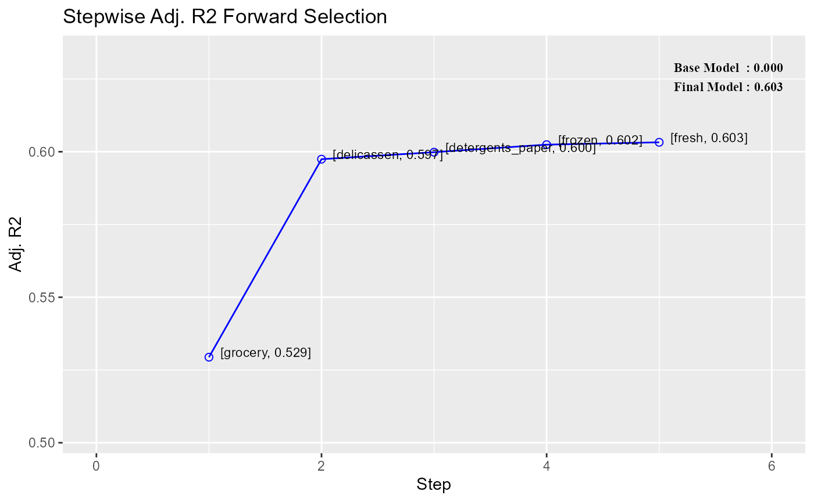

# Variable Selection Methods

# Variable Selection Methods

Source:
[`vignettes/variable_selection.Rmd`](https://github.com/rsquaredacademy/olsrr/blob/HEAD/vignettes/variable_selection.Rmd)

`variable_selection.Rmd`

The examples use annual spending by 440 wholesale customers. They ask
how milk spending relates to spending in other product categories; these
are observational associations. See
[`?wholesale_customers`](https://olsrr.rsquaredacademy.com/dev/reference/wholesale_customers.md)
for source and units.

## Introduction

Variable selection refers to the process of choosing the most relevant
variables to include in a regression model. They help to improve model
performance and avoid over fitting.

Before we explore stepwise selection methods, let us take a quick look
at all/best subset regression. As they evaluate every possible variable
combination, these methods are computationally intensive and may crash
your system if used with a large set of variables. We have included them
in the package purely for educational purpose.

### All Possible Regression

All subset regression tests all possible subsets of the set of potential
independent variables. If there are K potential independent variables
(besides the constant), then there are $`2^{k}`$ distinct subsets of
them to be tested. For example, if you have 10 candidate independent
variables, the number of subsets to be tested is $`2^{10}`$, which is
1024, and if you have 20 candidate variables, the number is $`2^{20}`$,
which is more than one million.

\
`model`` ``<-`` `[`lm`](https://rdrr.io/r/stats/lm.html)`(``milk`` ``~`` ``grocery`` ``+`` ``detergents_paper`` ``+`` ``fresh`` ``+`` ``frozen``, data ``=`` ``wholesale_customers``)`\
[`ols_step_all_possible`](https://olsrr.rsquaredacademy.com/dev/reference/ols_step_all_possible.md)`(``model``)`

    ##    Index N                            Predictors   R-Square Adj. R-Square
    ## 1      1 1                               grocery 0.53047204   0.529400063
    ## 2      2 1                      detergents_paper 0.43799999   0.436716888
    ## 4      3 1                                frozen 0.01537445   0.013126449
    ## 3      4 1                                 fresh 0.01010221   0.007842173
    ## 7      5 2                        grocery frozen 0.55400099   0.551959808
    ## 6      6 2                         grocery fresh 0.54238599   0.540291649
    ## 5      7 2              grocery detergents_paper 0.53140501   0.529260415
    ## 9      8 2               detergents_paper frozen 0.48332146   0.480956800
    ## 8      9 2                detergents_paper fresh 0.46651495   0.464073374
    ## 10    10 2                          fresh frozen 0.01914603   0.014656994
    ## 13    11 3                  grocery fresh frozen 0.55757823   0.554534048
    ## 12    12 3       grocery detergents_paper frozen 0.55406080   0.550992413
    ## 11    13 3        grocery detergents_paper fresh 0.54240712   0.539258549
    ## 14    14 3         detergents_paper fresh frozen 0.49395680   0.490474852
    ## 15    15 4 grocery detergents_paper fresh frozen 0.55790487   0.553839626
    ##    Mallow's Cp
    ## 1    25.992559
    ## 2   116.980537
    ## 4   532.823412
    ## 3   538.011037
    ## 7     4.841223
    ## 6    16.269817
    ## 5    27.074562
    ## 9    74.386427
    ## 8    90.923210
    ## 10  531.112366
    ## 13    3.321393
    ## 12    6.782374
    ## 11   18.249024
    ## 14   65.921774
    ## 15    5.000000

### Best Subset Regression

Select the subset of predictors that do the best at meeting some
well-defined objective criterion, such as having the largest R2 value or
the smallest MSE, Mallow’s Cp or AIC.

\
`model`` ``<-`` `[`lm`](https://rdrr.io/r/stats/lm.html)`(``milk`` ``~`` ``grocery`` ``+`` ``detergents_paper`` ``+`` ``fresh`` ``+`` ``frozen``, data ``=`` ``wholesale_customers``)`\
[`ols_step_best_subset`](https://olsrr.rsquaredacademy.com/dev/reference/ols_step_best_subset.md)`(``model``)`

    ##               Best Subsets Regression               
    ## ----------------------------------------------------
    ## Model Index    Predictors
    ## ----------------------------------------------------
    ##      1         grocery                               
    ##      2         grocery frozen                        
    ##      3         grocery fresh frozen                  
    ##      4         grocery detergents_paper fresh frozen 
    ## ----------------------------------------------------
    ## 
    ##                                                              Subsets Regression Summary                                                              
    ## -----------------------------------------------------------------------------------------------------------------------------------------------------
    ##                        Adj.        Pred                                                                                                               
    ## Model    R-Square    R-Square    R-Square     C(p)         AIC         SBIC          SBC           MSEP              FPE            HSP         APC  
    ## -----------------------------------------------------------------------------------------------------------------------------------------------------
    ##   1        0.5305      0.5294      0.5088    25.9926    8758.8031    7509.9423    8771.0634    25750612.6184    25750079.3635    58658.0393    0.4738 
    ##   2        0.5540      0.5520      0.5237     4.8412    8738.1822    7489.5321    8754.5293    24572402.6404    24571130.5004    55974.1619    0.4521 
    ##   3        0.5576      0.5545      0.5239     3.3214    8736.6389    7488.0587    8757.0727    24487384.2572    24485102.3278    55780.4961    0.4505 
    ##   4        0.5579      0.5538       0.505     5.0000    8738.3139    7489.7627    8762.8346    24582067.2939    24578503.9008    55996.1773    0.4523 
    ## -----------------------------------------------------------------------------------------------------------------------------------------------------
    ## AIC: Akaike Information Criteria 
    ##  SBIC: Sawa's Bayesian Information Criteria 
    ##  SBC: Schwarz Bayesian Criteria 
    ##  MSEP: Estimated error of prediction, assuming multivariate normality 
    ##  FPE: Final Prediction Error 
    ##  HSP: Hocking's Sp 
    ##  APC: Amemiya Prediction Criteria

## Stepwise Selection

Stepwise regression is a method of fitting regression models that
involves the iterative selection of independent variables to use in a
model. It can be achieved through forward selection, backward
elimination, or a combination of both methods. The forward selection
approach starts with no variables and adds each new variable
incrementally, testing for statistical significance, while the backward
elimination method begins with a full model and then removes the least
statistically significant variables one at a time.

### Model

We will use the below model throughout this article except in the case
of hierarchical selection. The wholesale customer data record annual
spending by product category. Can spending in the other categories help
explain milk spending?

\
`model`` ``<-`` `[`lm`](https://rdrr.io/r/stats/lm.html)`(``milk`` ``~`` ``grocery`` ``+`` ``detergents_paper`` ``+`` ``fresh`` ``+`` ``frozen`` ``+`` ``delicassen``, data ``=`` ``wholesale_customers``)`\
[`summary`](https://rdrr.io/r/base/summary.html)`(``model``)`

    ## 
    ## Call:
    ## lm(formula = milk ~ grocery + detergents_paper + fresh + frozen + 
    ##     delicassen, data = wholesale_customers)
    ## 
    ## Residuals:
    ##    Min     1Q Median     3Q    Max 
    ## -33874  -1543   -527    865  53454 
    ## 
    ## Coefficients:
    ##                   Estimate Std. Error t value Pr(>|t|)    
    ## (Intercept)      262.75163  369.34483   0.711   0.4772    
    ## grocery            0.38395    0.06674   5.753 1.66e-08 ***
    ## detergents_paper   0.30689    0.13166   2.331   0.0202 *  
    ## fresh              0.02613    0.01905   1.372   0.1709    
    ## frozen             0.08068    0.05233   1.542   0.1239    
    ## delicassen         0.67869    0.09138   7.427 5.94e-13 ***
    ## ---
    ## Signif. codes:  0 '***' 0.001 '**' 0.01 '*' 0.05 '.' 0.1 ' ' 1
    ## 
    ## Residual standard error: 4649 on 434 degrees of freedom
    ## Multiple R-squared:  0.6078, Adjusted R-squared:  0.6032 
    ## F-statistic: 134.5 on 5 and 434 DF,  p-value: < 2.2e-16

### Model specification

Irrespective of the stepwise method being used, we have to specify the
full model i.e. all the variabels/predictors under consideration as
`olsrr` extracts the candidate variables for selection/elimination from
the model specified.

##### Forward selection

\
`# stepwise forward regression`\
[`ols_step_forward_p`](https://olsrr.rsquaredacademy.com/dev/reference/ols_step_forward_p.md)`(``model``)`

    ## 
    ## 
    ##                                   Stepwise Summary                                  
    ## ----------------------------------------------------------------------------------
    ## Step    Variable              AIC         SBC         SBIC        R2       Adj. R2 
    ## ----------------------------------------------------------------------------------
    ##  0      Base Model          9089.455    9097.629    7838.859    0.00000    0.00000 
    ##  1      grocery             8758.803    8771.063    7509.478    0.53047    0.52940 
    ##  2      delicassen          8691.088    8707.435    7442.376    0.59927    0.59744 
    ##  3      detergents_paper    8689.441    8709.875    7440.780    0.60258    0.59984 
    ##  4      frozen              8687.574    8712.095    7439.003    0.60606    0.60243 
    ##  5      fresh               8687.671    8716.279    7439.171    0.60776    0.60324 
    ## ----------------------------------------------------------------------------------
    ## 
    ## Final Model Output 
    ## ------------------
    ## 
    ##                              Model Summary                              
    ## -----------------------------------------------------------------------
    ## R                          0.780       RMSE                   4648.832 
    ## R-Squared                  0.608       MSE                21611643.326 
    ## Adj. R-Squared             0.603       Coef. Var                80.204 
    ## Pred R-Squared             0.563       AIC                    8687.671 
    ## MAE                     2395.939       SBC                    8716.279 
    ## -----------------------------------------------------------------------
    ##  RMSE: Root Mean Square Error 
    ##  MSE: Mean Square Error 
    ##  MAE: Mean Absolute Error 
    ##  AIC: Akaike Information Criteria 
    ##  SBC: Schwarz Bayesian Criteria 
    ## 
    ##                                       ANOVA                                        
    ## ----------------------------------------------------------------------------------
    ##                        Sum of                                                     
    ##                       Squares         DF       Mean Square       F           Sig. 
    ## ----------------------------------------------------------------------------------
    ## Regression    14532862414.278          5    2906572482.856    134.491    < 0.0001 
    ## Residual       9379453203.611        434      21611643.326                        
    ## Total         23912315617.889        439                                          
    ## ----------------------------------------------------------------------------------
    ## 
    ##                                         Parameter Estimates                                         
    ## ---------------------------------------------------------------------------------------------------
    ##            model       Beta    Std. Error    Std. Beta      t        Sig          lower      upper 
    ## ---------------------------------------------------------------------------------------------------
    ##      (Intercept)    262.752       369.345                 0.711      0.4772    -463.175    988.679 
    ##          grocery      0.384         0.067        0.494    5.753    < 0.0001       0.253      0.515 
    ##       delicassen      0.679         0.091        0.259    7.427    < 0.0001       0.499      0.858 
    ## detergents_paper      0.307         0.132        0.198    2.331      0.0202       0.048      0.566 
    ##           frozen      0.081         0.052        0.053    1.542      0.1239      -0.022      0.184 
    ##            fresh      0.026         0.019        0.045    1.372      0.1709      -0.011      0.064 
    ## ---------------------------------------------------------------------------------------------------

##### Backward elimination

\
`# stepwise backward regression`\
[`ols_step_backward_p`](https://olsrr.rsquaredacademy.com/dev/reference/ols_step_backward_p.md)`(``model``)`

    ## [1] "No variables have been removed from the model."

### Criteria

The criteria for selecting variables may be one of the following:

- p value
- akaike information criterion (aic)
- schwarz bayesian criterion (sbc)
- sawa bayesian criterion (sbic)
- r-square
- adjusted r-square

### Include/exclude variables

We can force variables to be included or excluded from the model at all
stages of variable selection. The variables may be specified either by
name or position in the model specified.

##### By name

\
[`ols_step_forward_p`](https://olsrr.rsquaredacademy.com/dev/reference/ols_step_forward_p.md)`(``model``, include ``=`` `[`c`](https://rdrr.io/r/base/c.html)`(``"grocery"``, ``"fresh"``)``)`

    ## 
    ## 
    ##                                Stepwise Summary                               
    ## ----------------------------------------------------------------------------
    ## Step    Variable        AIC         SBC         SBIC        R2       Adj. R2 
    ## ----------------------------------------------------------------------------
    ##  0      Base Model    8749.494    8765.841    7500.008    0.54239    0.54029 
    ##  1      grocery       8758.803    8771.063    7509.478    0.53047    0.52940 
    ##  2      fresh         8749.494    8765.841    7500.008    0.54239    0.54029 
    ##  3      delicassen    8690.923    8711.357    7442.235    0.60124    0.59849 
    ## ----------------------------------------------------------------------------
    ## 
    ## Final Model Output 
    ## ------------------
    ## 
    ##                              Model Summary                              
    ## -----------------------------------------------------------------------
    ## R                          0.775       RMSE                   4676.537 
    ## R-Squared                  0.601       MSE                21869998.439 
    ## Adj. R-Squared             0.598       Coef. Var                80.682 
    ## Pred R-Squared             0.574       AIC                    8690.923 
    ## MAE                     2407.196       SBC                    8711.357 
    ## -----------------------------------------------------------------------
    ##  RMSE: Root Mean Square Error 
    ##  MSE: Mean Square Error 
    ##  MAE: Mean Absolute Error 
    ##  AIC: Akaike Information Criteria 
    ##  SBC: Schwarz Bayesian Criteria 
    ## 
    ##                                       ANOVA                                        
    ## ----------------------------------------------------------------------------------
    ##                        Sum of                                                     
    ##                       Squares         DF       Mean Square       F           Sig. 
    ## ----------------------------------------------------------------------------------
    ## Regression         1.4377e+10          3    4792332099.564    219.128    < 0.0001 
    ## Residual       9535319319.196        436      21869998.439                        
    ## Total         23912315617.889        439                                          
    ## ----------------------------------------------------------------------------------
    ## 
    ##                                       Parameter Estimates                                       
    ## -----------------------------------------------------------------------------------------------
    ##       model       Beta    Std. Error    Std. Beta      t         Sig          lower      upper 
    ## -----------------------------------------------------------------------------------------------
    ## (Intercept)    277.064       362.416                  0.764      0.4450    -435.235    989.363 
    ##     grocery      0.525         0.024        0.676    21.836    < 0.0001       0.478      0.572 
    ##       fresh      0.027         0.018        0.046     1.466      0.1432      -0.009      0.063 
    ##  delicassen      0.670         0.084        0.256     8.022    < 0.0001       0.506      0.835 
    ## -----------------------------------------------------------------------------------------------

##### By index

\
[`ols_step_forward_p`](https://olsrr.rsquaredacademy.com/dev/reference/ols_step_forward_p.md)`(``model``, include ``=`` `[`c`](https://rdrr.io/r/base/c.html)`(``2``, ``4``)``)`

    ## 
    ## 
    ##                                   Stepwise Summary                                  
    ## ----------------------------------------------------------------------------------
    ## Step    Variable              AIC         SBC         SBIC        R2       Adj. R2 
    ## ----------------------------------------------------------------------------------
    ##  0      Base Model          8802.908    8819.255    7552.754    0.48332    0.48096 
    ##  1      detergents_paper    8837.904    8850.164    7587.897    0.43800    0.43672 
    ##  2      frozen              8802.908    8819.255    7552.754    0.48332    0.48096 
    ##  3      delicassen          8720.085    8740.519    7470.877    0.57391    0.57098 
    ## ----------------------------------------------------------------------------------
    ## 
    ## Final Model Output 
    ## ------------------
    ## 
    ##                              Model Summary                              
    ## -----------------------------------------------------------------------
    ## R                          0.758       RMSE                   4834.109 
    ## R-Squared                  0.574       MSE                23368610.896 
    ## Adj. R-Squared             0.571       Coef. Var                83.400 
    ## Pred R-Squared             0.536       AIC                    8720.085 
    ## MAE                     2610.090       SBC                    8740.519 
    ## -----------------------------------------------------------------------
    ##  RMSE: Root Mean Square Error 
    ##  MSE: Mean Square Error 
    ##  MAE: Mean Absolute Error 
    ##  AIC: Akaike Information Criteria 
    ##  SBC: Schwarz Bayesian Criteria 
    ## 
    ##                                       ANOVA                                        
    ## ----------------------------------------------------------------------------------
    ##                        Sum of                                                     
    ##                       Squares         DF       Mean Square       F           Sig. 
    ## ----------------------------------------------------------------------------------
    ## Regression    13723601267.393          3    4574533755.798    195.755    < 0.0001 
    ## Residual      10188714350.496        436      23368610.896                        
    ## Total         23912315617.889        439                                          
    ## ----------------------------------------------------------------------------------
    ## 
    ##                                          Parameter Estimates                                          
    ## -----------------------------------------------------------------------------------------------------
    ##            model        Beta    Std. Error    Std. Beta      t         Sig         lower       upper 
    ## -----------------------------------------------------------------------------------------------------
    ##      (Intercept)    1206.817       320.662                  3.764      0.0002    576.581    1837.053 
    ## detergents_paper       1.005         0.049        0.650    20.416    < 0.0001      0.909       1.102 
    ##           frozen       0.122         0.052        0.080     2.333      0.0201      0.019       0.225 
    ##       delicassen       0.863         0.090        0.330     9.628    < 0.0001      0.687       1.040 
    ## -----------------------------------------------------------------------------------------------------

### Standardized output

All stepwise selection methods display standard output which includes:

- selection summary
- model summary
- ANOVA
- parameter estimates

\
`# adjusted r-square `\
[`ols_step_forward_adj_r2`](https://olsrr.rsquaredacademy.com/dev/reference/ols_step_forward_adj_r2.md)`(``model``)`

    ## 
    ## 
    ##                                   Stepwise Summary                                  
    ## ----------------------------------------------------------------------------------
    ## Step    Variable              AIC         SBC         SBIC        R2       Adj. R2 
    ## ----------------------------------------------------------------------------------
    ##  0      Base Model          9089.455    9097.629    7838.859    0.00000    0.00000 
    ##  1      grocery             8758.803    8771.063    7509.478    0.53047    0.52940 
    ##  2      delicassen          8691.088    8707.435    7442.376    0.59927    0.59744 
    ##  3      detergents_paper    8689.441    8709.875    7440.780    0.60258    0.59984 
    ##  4      frozen              8687.574    8712.095    7439.003    0.60606    0.60243 
    ##  5      fresh               8687.671    8716.279    7439.171    0.60776    0.60324 
    ## ----------------------------------------------------------------------------------
    ## 
    ## Final Model Output 
    ## ------------------
    ## 
    ##                              Model Summary                              
    ## -----------------------------------------------------------------------
    ## R                          0.780       RMSE                   4648.832 
    ## R-Squared                  0.608       MSE                21611643.326 
    ## Adj. R-Squared             0.603       Coef. Var                80.204 
    ## Pred R-Squared             0.563       AIC                    8687.671 
    ## MAE                     2395.939       SBC                    8716.279 
    ## -----------------------------------------------------------------------
    ##  RMSE: Root Mean Square Error 
    ##  MSE: Mean Square Error 
    ##  MAE: Mean Absolute Error 
    ##  AIC: Akaike Information Criteria 
    ##  SBC: Schwarz Bayesian Criteria 
    ## 
    ##                                       ANOVA                                        
    ## ----------------------------------------------------------------------------------
    ##                        Sum of                                                     
    ##                       Squares         DF       Mean Square       F           Sig. 
    ## ----------------------------------------------------------------------------------
    ## Regression    14532862414.278          5    2906572482.856    134.491    < 0.0001 
    ## Residual       9379453203.611        434      21611643.326                        
    ## Total         23912315617.889        439                                          
    ## ----------------------------------------------------------------------------------
    ## 
    ##                                         Parameter Estimates                                         
    ## ---------------------------------------------------------------------------------------------------
    ##            model       Beta    Std. Error    Std. Beta      t        Sig          lower      upper 
    ## ---------------------------------------------------------------------------------------------------
    ##      (Intercept)    262.752       369.345                 0.711      0.4772    -463.175    988.679 
    ##          grocery      0.384         0.067        0.494    5.753    < 0.0001       0.253      0.515 
    ##       delicassen      0.679         0.091        0.259    7.427    < 0.0001       0.499      0.858 
    ## detergents_paper      0.307         0.132        0.198    2.331      0.0202       0.048      0.566 
    ##           frozen      0.081         0.052        0.053    1.542      0.1239      -0.022      0.184 
    ##            fresh      0.026         0.019        0.045    1.372      0.1709      -0.011      0.064 
    ## ---------------------------------------------------------------------------------------------------

### Visualization

Use the [`plot()`](https://rdrr.io/r/graphics/plot.default.html) method
to visualize variable selection. It will display how the variable
selection criteria changes at each step of the selection process along
with the variable selected.

\
`# adjusted r-square `\
`k`` ``<-`` `[`ols_step_forward_adj_r2`](https://olsrr.rsquaredacademy.com/dev/reference/ols_step_forward_adj_r2.md)`(``model``)`\
[`plot`](https://rdrr.io/r/graphics/plot.default.html)`(``k``)`

### Verbose output

To view the detailed regression output at each stage of variable
selection/elimination, set `details` to `TRUE`. It will display the
following information at each step:

- step number
- variable selected/eliminated
- model
- value of the criteria at that stage

\
`# adjusted r-square `\
[`ols_step_forward_adj_r2`](https://olsrr.rsquaredacademy.com/dev/reference/ols_step_forward_adj_r2.md)`(``model``, details ``=`` ``TRUE``)`

    ## Forward Selection Method 
    ## ------------------------
    ## 
    ## Candidate Terms: 
    ## 
    ## 1. grocery 
    ## 2. detergents_paper 
    ## 3. fresh 
    ## 4. frozen 
    ## 5. delicassen 
    ## 
    ## 
    ## Step     => 0 
    ## Model    => milk ~ 1 
    ## Adj. R2  => 0 
    ## 
    ## Initiating stepwise selection... 
    ## 
    ##                           Table: Adding New Variables                            
    ## --------------------------------------------------------------------------------
    ## Predictor           DF      AIC         SBC         SBIC        R2       Adj. R2 
    ## --------------------------------------------------------------------------------
    ## grocery              1    8758.803    8771.063    7509.478    0.53047    0.52940 
    ## detergents_paper     1    8837.904    8850.164    7587.897    0.43800    0.43672 
    ## delicassen           1    9012.042    9024.302    7760.732    0.16514    0.16323 
    ## frozen               1    9084.638    9096.898    7832.877    0.01537    0.01313 
    ## fresh                1    9086.988    9099.248    7835.213    0.01010    0.00784 
    ## --------------------------------------------------------------------------------
    ## 
    ## Step     => 1 
    ## Added    => grocery 
    ## Model    => milk ~ grocery 
    ## Adj. R2  => 0.5294 
    ## 
    ##                           Table: Adding New Variables                            
    ## --------------------------------------------------------------------------------
    ## Predictor           DF      AIC         SBC         SBIC        R2       Adj. R2 
    ## --------------------------------------------------------------------------------
    ## delicassen           1    8691.088    8707.435    7442.376    0.59927    0.59744 
    ## frozen               1    8738.182    8754.529    7488.843    0.55400    0.55196 
    ## fresh                1    8749.494    8765.841    7500.008    0.54239    0.54029 
    ## detergents_paper     1    8759.928    8776.275    7510.308    0.53141    0.52926 
    ## --------------------------------------------------------------------------------
    ## 
    ## Step     => 2 
    ## Added    => delicassen 
    ## Model    => milk ~ grocery + delicassen 
    ## Adj. R2  => 0.59744 
    ## 
    ##                           Table: Adding New Variables                            
    ## --------------------------------------------------------------------------------
    ## Predictor           DF      AIC         SBC         SBIC        R2       Adj. R2 
    ## --------------------------------------------------------------------------------
    ## detergents_paper     1    8689.441    8709.875    7440.780    0.60258    0.59984 
    ## frozen               1    8690.253    8710.687    7441.577    0.60184    0.59911 
    ## fresh                1    8690.923    8711.357    7442.235    0.60124    0.59849 
    ## --------------------------------------------------------------------------------
    ## 
    ## Step     => 3 
    ## Added    => detergents_paper 
    ## Model    => milk ~ grocery + delicassen + detergents_paper 
    ## Adj. R2  => 0.59984 
    ## 
    ##                        Table: Adding New Variables                        
    ## -------------------------------------------------------------------------
    ## Predictor    DF      AIC         SBC         SBIC        R2       Adj. R2 
    ## -------------------------------------------------------------------------
    ## frozen        1    8687.574    8712.095    7439.003    0.60606    0.60243 
    ## fresh         1    8688.075    8712.595    7439.492    0.60561    0.60198 
    ## -------------------------------------------------------------------------
    ## 
    ## Step     => 4 
    ## Added    => frozen 
    ## Model    => milk ~ grocery + delicassen + detergents_paper + frozen 
    ## Adj. R2  => 0.60243 
    ## 
    ##                        Table: Adding New Variables                        
    ## -------------------------------------------------------------------------
    ## Predictor    DF      AIC         SBC         SBIC        R2       Adj. R2 
    ## -------------------------------------------------------------------------
    ## fresh         1    8687.671    8716.279    7439.171    0.60776    0.60324 
    ## -------------------------------------------------------------------------
    ## 
    ## 
    ## Variables Selected: 
    ## 
    ## => grocery 
    ## => delicassen 
    ## => detergents_paper 
    ## => frozen 
    ## => fresh

    ## 
    ## 
    ##                                   Stepwise Summary                                  
    ## ----------------------------------------------------------------------------------
    ## Step    Variable              AIC         SBC         SBIC        R2       Adj. R2 
    ## ----------------------------------------------------------------------------------
    ##  0      Base Model          9089.455    9097.629    7838.859    0.00000    0.00000 
    ##  1      grocery             8758.803    8771.063    7509.478    0.53047    0.52940 
    ##  2      delicassen          8691.088    8707.435    7442.376    0.59927    0.59744 
    ##  3      detergents_paper    8689.441    8709.875    7440.780    0.60258    0.59984 
    ##  4      frozen              8687.574    8712.095    7439.003    0.60606    0.60243 
    ##  5      fresh               8687.671    8716.279    7439.171    0.60776    0.60324 
    ## ----------------------------------------------------------------------------------
    ## 
    ## Final Model Output 
    ## ------------------
    ## 
    ##                              Model Summary                              
    ## -----------------------------------------------------------------------
    ## R                          0.780       RMSE                   4648.832 
    ## R-Squared                  0.608       MSE                21611643.326 
    ## Adj. R-Squared             0.603       Coef. Var                80.204 
    ## Pred R-Squared             0.563       AIC                    8687.671 
    ## MAE                     2395.939       SBC                    8716.279 
    ## -----------------------------------------------------------------------
    ##  RMSE: Root Mean Square Error 
    ##  MSE: Mean Square Error 
    ##  MAE: Mean Absolute Error 
    ##  AIC: Akaike Information Criteria 
    ##  SBC: Schwarz Bayesian Criteria 
    ## 
    ##                                       ANOVA                                        
    ## ----------------------------------------------------------------------------------
    ##                        Sum of                                                     
    ##                       Squares         DF       Mean Square       F           Sig. 
    ## ----------------------------------------------------------------------------------
    ## Regression    14532862414.278          5    2906572482.856    134.491    < 0.0001 
    ## Residual       9379453203.611        434      21611643.326                        
    ## Total         23912315617.889        439                                          
    ## ----------------------------------------------------------------------------------
    ## 
    ##                                         Parameter Estimates                                         
    ## ---------------------------------------------------------------------------------------------------
    ##            model       Beta    Std. Error    Std. Beta      t        Sig          lower      upper 
    ## ---------------------------------------------------------------------------------------------------
    ##      (Intercept)    262.752       369.345                 0.711      0.4772    -463.175    988.679 
    ##          grocery      0.384         0.067        0.494    5.753    < 0.0001       0.253      0.515 
    ##       delicassen      0.679         0.091        0.259    7.427    < 0.0001       0.499      0.858 
    ## detergents_paper      0.307         0.132        0.198    2.331      0.0202       0.048      0.566 
    ##           frozen      0.081         0.052        0.053    1.542      0.1239      -0.022      0.184 
    ##            fresh      0.026         0.019        0.045    1.372      0.1709      -0.011      0.064 
    ## ---------------------------------------------------------------------------------------------------

### Progress

To view the progress in the variable selection procedure, set `progress`
to `TRUE`. It will display the variable being selected/eliminated at
each step until there are no more candidate variables left.

\
`# adjusted r-square `\
[`ols_step_forward_adj_r2`](https://olsrr.rsquaredacademy.com/dev/reference/ols_step_forward_adj_r2.md)`(``model``, progress ``=`` ``TRUE``)`

    ## Forward Selection Method 
    ## ------------------------
    ## 
    ## Candidate Terms: 
    ## 
    ## 1. grocery 
    ## 2. detergents_paper 
    ## 3. fresh 
    ## 4. frozen 
    ## 5. delicassen 
    ## 
    ## 
    ## Variables Entered: 
    ## 
    ## => grocery 
    ## => delicassen 
    ## => detergents_paper 
    ## => frozen 
    ## => fresh

    ## 
    ## 
    ##                                   Stepwise Summary                                  
    ## ----------------------------------------------------------------------------------
    ## Step    Variable              AIC         SBC         SBIC        R2       Adj. R2 
    ## ----------------------------------------------------------------------------------
    ##  0      Base Model          9089.455    9097.629    7838.859    0.00000    0.00000 
    ##  1      grocery             8758.803    8771.063    7509.478    0.53047    0.52940 
    ##  2      delicassen          8691.088    8707.435    7442.376    0.59927    0.59744 
    ##  3      detergents_paper    8689.441    8709.875    7440.780    0.60258    0.59984 
    ##  4      frozen              8687.574    8712.095    7439.003    0.60606    0.60243 
    ##  5      fresh               8687.671    8716.279    7439.171    0.60776    0.60324 
    ## ----------------------------------------------------------------------------------
    ## 
    ## Final Model Output 
    ## ------------------
    ## 
    ##                              Model Summary                              
    ## -----------------------------------------------------------------------
    ## R                          0.780       RMSE                   4648.832 
    ## R-Squared                  0.608       MSE                21611643.326 
    ## Adj. R-Squared             0.603       Coef. Var                80.204 
    ## Pred R-Squared             0.563       AIC                    8687.671 
    ## MAE                     2395.939       SBC                    8716.279 
    ## -----------------------------------------------------------------------
    ##  RMSE: Root Mean Square Error 
    ##  MSE: Mean Square Error 
    ##  MAE: Mean Absolute Error 
    ##  AIC: Akaike Information Criteria 
    ##  SBC: Schwarz Bayesian Criteria 
    ## 
    ##                                       ANOVA                                        
    ## ----------------------------------------------------------------------------------
    ##                        Sum of                                                     
    ##                       Squares         DF       Mean Square       F           Sig. 
    ## ----------------------------------------------------------------------------------
    ## Regression    14532862414.278          5    2906572482.856    134.491    < 0.0001 
    ## Residual       9379453203.611        434      21611643.326                        
    ## Total         23912315617.889        439                                          
    ## ----------------------------------------------------------------------------------
    ## 
    ##                                         Parameter Estimates                                         
    ## ---------------------------------------------------------------------------------------------------
    ##            model       Beta    Std. Error    Std. Beta      t        Sig          lower      upper 
    ## ---------------------------------------------------------------------------------------------------
    ##      (Intercept)    262.752       369.345                 0.711      0.4772    -463.175    988.679 
    ##          grocery      0.384         0.067        0.494    5.753    < 0.0001       0.253      0.515 
    ##       delicassen      0.679         0.091        0.259    7.427    < 0.0001       0.499      0.858 
    ## detergents_paper      0.307         0.132        0.198    2.331      0.0202       0.048      0.566 
    ##           frozen      0.081         0.052        0.053    1.542      0.1239      -0.022      0.184 
    ##            fresh      0.026         0.019        0.045    1.372      0.1709      -0.011      0.064 
    ## ---------------------------------------------------------------------------------------------------

### Hierarchical selection

When using `p` values as the criterion for selecting/eliminating
variables, we can enable hierarchical selection. In this method, the
search for the most significant variable is restricted to the next
available variable. In the example below, selection stops at the first
spending category that does not meet the threshold; later categories are
not considered. You can learn more about hierachichal selection
[here](https://www.stata.com/manuals/rstepwise.pdf).

\
`# hierarchical selection`\
`m`` ``<-`` `[`lm`](https://rdrr.io/r/stats/lm.html)`(``milk`` ``~`` ``grocery`` ``+`` ``detergents_paper`` ``+`` ``fresh`` ``+`` ``frozen`` ``+`` ``delicassen``, data ``=`` ``wholesale_customers``)`\
[`ols_step_forward_p`](https://olsrr.rsquaredacademy.com/dev/reference/ols_step_forward_p.md)`(``m``, ``0.1``, hierarchical ``=`` ``TRUE``)`

    ## 
    ## 
    ##                                Stepwise Summary                               
    ## ----------------------------------------------------------------------------
    ## Step    Variable        AIC         SBC         SBIC        R2       Adj. R2 
    ## ----------------------------------------------------------------------------
    ##  0      Base Model    9089.455    9097.629    7838.859    0.00000    0.00000 
    ##  1      grocery       8758.803    8771.063    7509.478    0.53047    0.52940 
    ## ----------------------------------------------------------------------------
    ## 
    ## Final Model Output 
    ## ------------------
    ## 
    ##                              Model Summary                              
    ## -----------------------------------------------------------------------
    ## R                          0.728       RMSE                   5062.960 
    ## R-Squared                  0.530       MSE                25633563.167 
    ## Adj. R-Squared             0.529       Coef. Var                87.349 
    ## Pred R-Squared             0.509       AIC                    8758.803 
    ## MAE                     2557.458       SBC                    8771.063 
    ## -----------------------------------------------------------------------
    ##  RMSE: Root Mean Square Error 
    ##  MSE: Mean Square Error 
    ##  MAE: Mean Absolute Error 
    ##  AIC: Akaike Information Criteria 
    ##  SBC: Schwarz Bayesian Criteria 
    ## 
    ##                                        ANOVA                                        
    ## -----------------------------------------------------------------------------------
    ##                        Sum of                                                      
    ##                       Squares         DF        Mean Square       F           Sig. 
    ## -----------------------------------------------------------------------------------
    ## Regression    12684814950.626          1    12684814950.626    494.852    < 0.0001 
    ## Residual      11227500667.262        438       25633563.167                        
    ## Total         23912315617.889        439                                           
    ## -----------------------------------------------------------------------------------
    ## 
    ##                                       Parameter Estimates                                        
    ## ------------------------------------------------------------------------------------------------
    ##       model        Beta    Std. Error    Std. Beta      t         Sig         lower       upper 
    ## ------------------------------------------------------------------------------------------------
    ## (Intercept)    1298.690       314.858                  4.125    < 0.0001    679.870    1917.509 
    ##     grocery       0.566         0.025        0.728    22.245    < 0.0001      0.516       0.616 
    ## ------------------------------------------------------------------------------------------------
